# 02. Quy Tắc Nghiệp Vụ & Luồng Vận Hành Chuẩn (Business Rules & Workflows)

> **Nguyên tắc phân định nguồn đặc tả:**
> - **Sự thật từ FE & Mock Data:** Phản ánh giao diện hiện có (xem [`docs/01-fe-and-mock-audit.md`](file:///c:/Users/Admin/Documents/GitHub/TripOpsFE/docs/01-fe-and-mock-audit.md)).
> - **Quy tắc nghiệp vụ bắt buộc & Thiết kế đề xuất trong tài liệu này:** Là chuẩn đích (Source of Truth) để xây dựng Backend, chuẩn hóa Database ([`docs/03-database-design.md`](file:///c:/Users/Admin/Documents/GitHub/TripOpsFE/docs/03-database-design.md)) và API Contract ([`docs/04-api-contract.md`](file:///c:/Users/Admin/Documents/GitHub/TripOpsFE/docs/04-api-contract.md)).

---

## 1. Mô Hình Nghiệp Vụ B2B2C & Phân Định Vai Trò

TripOps là nền tảng quản lý và vận hành tour đoàn (Group Tour Operations Platform) theo mô hình **B2B2C**:

### 1.1. Trách nhiệm của 5 vai trò trên hệ thống
1. **Customer (Khách hàng đoàn / Doanh nghiệp / Cá nhân đại diện đoàn):**
   - Xem danh mục tour công khai, gửi yêu cầu thiết kế tour riêng (`CustomTourRequest`), xem/thương lượng các phiên bản báo giá (`Quotation`), tùy chỉnh dịch vụ, chấp nhận hợp đồng điện tử, quản lý danh sách hành khách (`booking_passengers`), thanh toán theo đợt (`payment_requests`) và gửi khiếu nại/yêu cầu hoàn tiền nếu phát sinh.
2. **Lead Agency (Công ty lữ hành chủ trì):**
   - Tạo và mở bán tour, lập báo giá cho khách, quản lý danh bạ Supplier riêng (`agency_suppliers`), chọn dịch vụ của Platform Partner, mời Agency địa phương đồng tổ chức chặng, đứng tên ký hợp đồng với Customer, điều phối Hướng dẫn viên và **chịu trách nhiệm chính trước Customer đối với toàn bộ gói tour mình bán**.
3. **Local Co-Host Agency (Công ty lữ hành địa phương đồng tổ chức):**
   - Nhận lời mời từ Lead Agency cho một hoặc nhiều chặng/tỉnh thành xác định, thương lượng phạm vi công việc và mức giá net theo chặng (`tour_co_host_agreements`), thực hiện dịch vụ/điều phối HDV tại chặng được giao (`booking_agency_shares`) và nhận quyết toán theo đúng phần việc đã nghiệm thu.
4. **Platform Partner (Nhà cung cấp dịch vụ trên nền tảng — Khách sạn, Nhà hàng, Vận chuyển, Vé tham quan):**
   - Có tài khoản trên TripOps, được Admin duyệt hồ sơ pháp lý (`business_profiles`), đăng dịch vụ (`provider_services`), nhận yêu cầu kiểm tra chỗ/báo giá đoàn (`partner_service_reservations`) trực tiếp từ Agency trên nền tảng.
5. **Tour Guide (Hướng dẫn viên):**
   - Thuộc quản lý của Agency (`guide_profiles`); sử dụng giao diện di động để xem lịch trình đoàn được phân công (`guide_assignments`), điểm danh hành khách khi xuất phát, check-in từng điểm đến kèm ảnh/ghi chú (`booking_location_checkins`), báo cáo sự cố hiện trường (`incident_and_disputes`) và gửi báo cáo tổng kết chuyến đi (`wrap_up_summary`).
6. **Platform Admin (Quản trị viên nền tảng):**
   - Thẩm định và phê duyệt hồ sơ pháp nhân của Agency & Platform Partner (`business_profiles`); hậu kiểm (tạm ẩn/gỡ) tour hoặc bài đăng dịch vụ vi phạm; xử lý khiếu nại/tranh chấp; duyệt hoàn tiền (`refund_requests`); duyệt tạm ứng vận hành (`operational_advances`) và thực hiện quyết toán giải ngân (`financial_settlements`).

### 1.2. Quy tắc xuất bản Tour & Dịch vụ (Không Tiền Kiểm Tour)
- **Agency tự publish tour:** Sau khi tài khoản pháp nhân của Agency đã được Admin phê duyệt (`business_profiles.approval_status = 'APPROVED'`), Agency có toàn quyền chuyển trạng thái tour từ `DRAFT` sang `PUBLISHED` (`visibility = 'PUBLIC'`) để xuất hiện ngay trên sàn.
- **Không thiết kế quy trình bắt buộc `agency submit tour -> admin approve -> publish`.**
- **Cơ chế hậu kiểm của Admin:** Nếu phát hiện tour hoặc bài đăng dịch vụ có nội dung sai lệch, vi phạm tiêu chuẩn hoặc bị báo cáo, Admin chuyển trạng thái sang `HIDDEN` (kèm `hidden_reason` bắt buộc) hoặc `ARCHIVED`.

### 1.3. Phân biệt rạch ròi: Supplier Riêng của Agency vs. Platform Partner

| Tiêu chí đối chiếu | 1. Supplier Riêng của Agency (`agency_suppliers`) | 2. Platform Partner (`business_profiles` + `provider_services`) |
| :--- | :--- | :--- |
| **Tài khoản trên TripOps** | **Không có** tài khoản trên nền tảng. Do nhân viên Agency tự nhập và quản lý. | **Có** tài khoản vai trò `PROVIDER`, đã qua xác minh MST/Giấy phép kinh doanh. |
| **Phạm vi hiển thị** | **Nội bộ riêng tư (`Private`)** thuộc đúng `agency_id` đã tạo. Agency khác tuyệt đối không nhìn thấy. | **Công khai B2B** cho tất cả các Agency trên nền tảng tra cứu trên bản đồ và chọn vào tour. |
| **Khóa ngoại khi đưa vào Tour/Booking** | Tham chiếu tới `agency_supplier_id` (hoặc lưu snapshot), **không bắt buộc và không dùng `platform_service_id`**. | Tham chiếu tới `platform_service_id` (`provider_services.id`) kèm snapshot tại thời điểm chốt. |
| **Luồng Reconfirm đặt chỗ** | Agency tự liên hệ ngoài hệ thống (điện thoại/email/Zalo) và tự cập nhật trạng thái xác nhận lên hệ thống. | Gửi phiếu `partner_service_reservations` trực tiếp trên TripOps; Partner bấm Xác nhận & Báo giá trên hệ thống. |
| **Luồng Thanh toán & Quyết toán** | **Agency tự thanh toán trực tiếp** cho Supplier riêng (từ nguồn tiền tạm ứng vận hành hoặc tiền quyết toán của Agency). Sàn **không** tạo lệnh settlement trực tiếp tới Supplier riêng. | Có thể được đối soát minh bạch trên nền tảng hoặc thông qua Agency theo thỏa thuận đặt dịch vụ. |
| **Quy tắc chống gộp tự động** | Kể cả khi tên Supplier riêng trùng khớp 100% với một Platform Partner, hệ thống **không tự động hợp nhất (merge)** hai bản ghi. | Là thực thể pháp nhân độc lập trên sàn. |

---

## 2. Luồng Vận Hành Chính Toàn Trình (End-to-End Main Flow)

```mermaid
flowchart TD
    A["1. Customer gửi Yêu cầu thiết kế riêng (Custom Request)<br/>hoặc Chọn Tour có sẵn + Tùy chỉnh"] --> B["2. Lead Agency thiết kế Lịch trình & Lập Báo giá (Quotation v1)<br/>(Chọn Platform Partner / Supplier riêng / Mời Local Co-Host)"]
    B --> C["3. Customer xem Báo giá (trong thời hạn hiệu lực)<br/>Thương lượng sửa đổi (tạo Quotation v2, v3...)"]
    C --> D["4. Reconfirm năng lực cung ứng & giá chốt<br/>(Platform Partner xác nhận chỗ + Local Co-Host chốt giá net chặng)"]
    D --> E["5. Customer chấp nhận Báo giá & Hợp đồng điện tử<br/>-> Tạo Booking kèm Snapshot bất biến (Locked Price & Terms)"]
    E --> F["6. Thanh toán theo từng đợt (Payment Installments)<br/>(Đợt 1: Đặt cọc giữ chỗ -> Đợt 2/Cuối: Thanh toán đủ trước khởi hành)"]
    F --> G["7. Chuẩn bị vận hành & Tạm ứng (Operational Advance)<br/>(Chốt danh sách hành khách, phân công HDV, giải ngân tạm ứng hợp lệ)"]
    G --> H["8. Vận hành Tour thực địa (Tour Operation)<br/>(HDV điểm danh xuất phát, check-in từng điểm đến, xử lý sự cố/Amendment)"]
    H --> I["9. Hoàn thành dịch vụ & Nghiệm thu (Service Completion)<br/>(HDV nộp báo cáo kết thúc tour, kiểm tra khiếu nại/vi phạm chặng)"]
    I --> J["10. Quyết toán & Giải ngân cuối cùng (Financial Settlement)<br/>(Khấu trừ phí sàn, trừ khoản đã tạm ứng, trừ phạt/hoàn tiền -> Giải ngân Net)"]
```

---

## 3. Thiết Kế Tour, Template, Clone & Booking Timeline

### 3.1. Mô hình `Tour`, `Quotation` và `Booking`
Để tránh dư thừa bảng nhưng vẫn tách bạch rõ vòng đời dữ liệu, hệ thống quy định:
1. **`tours` (Sản phẩm Tour / Template tái sử dụng):**
   - Bảng `tours` đóng vai trò vừa là **sản phẩm tour mở bán công khai**, vừa là **Template cấu hình lịch trình mẫu** (thông qua cờ `is_template: boolean` và `cloned_from_tour_id`). **Không tạo bảng `tour_templates` riêng biệt** chỉ vì khác tên gọi.
2. **`custom_tour_requests` + `quotation_versions` (Phương án & Báo giá theo đoàn):**
   - Là phương án lịch trình và bảng giá dành riêng cho một yêu cầu của Customer, có lịch sử phiên bản (`version_number = 1, 2, 3...`), thời hạn giữ giá (`price_locked_until`) và thời hạn hiệu lực báo giá (`quote_expires_at`).
3. **`bookings` (Chuyến đi đã chốt để vận hành):**
   - Khi Customer chấp nhận báo giá/tour và xác nhận đặt, hệ thống tạo bản ghi `bookings` kèm `tour_snapshot_json` ghi nhận toàn bộ cấu hình lịch trình, khách sạn, bữa ăn, điều khoản tại đúng thời điểm chốt.

### 3.2. Quy tắc Clone Tour theo Allowlist & Cấm Clone Booking đã diễn ra
- **Nguyên tắc cốt lõi:** **Tuyệt đối không cung cấp thao tác "Clone Booking"** đối với một chuyến đi đã hoặc đang diễn ra.
- **Thao tác 1 — Nhân bản Tour (`POST /api/v1/agency/tours/{id}/clone`):**
  - Tạo một bản ghi `tours` mới với `id` mới, `tour_code` mới, `cloned_from_tour_id = source_tour.id`, `status = 'DRAFT'`, `visibility = 'HIDDEN'`.
  - **Allowlist các trường được phép sao chép:**
    - Thông tin mô tả: `name` (thêm hậu tố `"(Bản sao)"`), `description`, `duration_text`, `number_of_days`, `number_of_nights`, `departure_location`, `transportation_type`, `min_guests`, `max_guests`, `thumbnail_url`, `images_json`, `highlights_json`.
    - Chính sách mẫu: `included_services`, `excluded_services`, `cancellation_policy`.
    - Cấu trúc điểm đến & lịch trình mẫu: `tour_destinations` (chỉ sao chép `province_id`, `stage_order`, `stage_name` — **xóa** `assigned_agency_id`), `tour_itinerary_days` và `tour_itinerary_items` (sao chép cấu trúc ngày, địa điểm, tham chiếu `platform_service_id` / `agency_supplier_id`), `tour_pricing_tiers` (giá tham khảo cần kiểm tra lại theo mùa).
  - **Denylist các dữ liệu tuyệt đối KHÔNG sao chép:**
    - Khách hàng (`customer_id`), danh sách hành khách (`booking_passengers`), hợp đồng (`booking_contracts`), đợt thanh toán & giao dịch (`payment_requests`, `payment_transactions`), phiếu đặt chỗ đối tác (`partner_service_reservations`), thỏa thuận đồng tổ chức cũ (`tour_co_host_agreements`), phân công HDV (`guide_assignments`), dữ liệu điểm danh/check-in (`booking_location_checkins`), sự cố/khiếu nại (`incident_and_disputes`), đánh giá sao (`reviews`) và quyết toán (`financial_settlements`).
- **Thao tác 2 — Tạo Template từ cấu hình lịch trình chuyến đi đã hoàn thành (`POST /api/v1/agency/bookings/{id}/extract-template`):**
  - Khi một chuyến đi (`Booking`) có nhiều thay đổi hay và Agency muốn tái sử dụng cho tương lai, hệ thống chỉ trích xuất **cấu hình khung lịch trình đã lọc sạch dữ liệu vận hành** từ `booking.tour_snapshot_json` (ngày, điểm đến, danh mục dịch vụ mẫu) để tạo một bản ghi `tours` mới ở trạng thái `DRAFT`, `is_template = true`. Không sao chép bất kỳ dữ liệu khách hàng hay giao dịch nào của Booking đó.

### 3.3. Thiết kế Booking Timeline ngắn gọn, tách biệt Phân công và Cấu trúc
- **Cấu trúc Timeline chuẩn:** Lưu trong `bookings.tour_snapshot_json` (để đối chiếu hợp đồng) và phẳng hóa các điểm cần check-in ra bảng `booking_location_checkins` (`booking_id`, `day_number`, `sort_order`, `location_name`, `scheduled_time`, `status`). Không tạo các bảng timeline trung gian rườm rà.
- **Tách biệt Phân công thực hiện:**
  - Trách nhiệm của từng Agency theo chặng/ngày được lưu ở `booking_agency_shares` (`assigned_days_json`, ví dụ `[1, 2]` cho Đà Lạt, `[3, 4]` cho Nha Trang).
  - Trách nhiệm của từng Hướng dẫn viên được lưu ở `guide_assignments` (`agency_share_id`, `guide_profile_id`) và liên kết trực tiếp tới `booking_location_checkins.guide_assignment_id`.

---

## 4. Danh Bạ Supplier Riêng Của Agency (`agency_suppliers`)

### 4.1. Nhập một lần, tái sử dụng nhiều lần
1. Khi thiết kế tour hoặc lập báo giá, nhân viên Agency có thể:
   - Chọn dịch vụ từ **Platform Partner** (`provider_services`), HOẶC
   - Tìm kiếm và chọn từ **Danh bạ Supplier riêng của Agency mình** (`agency_suppliers`), HOẶC
   - Nhập mới một Supplier riêng ngay trên form thiết kế tour (hệ thống tự động lưu vào `agency_suppliers` của Agency đó để tái sử dụng cho các lần sau).
2. **Thông tin lưu trữ tối giản, sát nhu cầu báo giá:**
   - `agency_id` (FK tới `business_profiles`), `province_id` (FK tới `provinces`), `supplier_type` (`HOTEL`, `FNB`, `TRANSPORT`, `ATTRACTION`, `OTHER`), `supplier_name`, `contact_name`, `contact_phone`, `contact_email`, `address`, `stars`, `reference_price_from`, `reference_price_to`, `service_tags_json`, `notes`, `status` (`ACTIVE` / `INACTIVE`).

### 4.2. Cơ chế Snapshot & Cô lập dữ liệu
- **Giá tham khảo vs. Giá chốt:** Giá trong `agency_suppliers` (`reference_price_from`, `reference_price_to`) chỉ là giá tham khảo trong danh bạ. Khi đưa vào báo giá/booking cụ thể, Agency phải nhập giá áp dụng theo ngày đi và quy mô đoàn.
- **Snapshot bất biến:** Khi lưu vào `tour_itinerary_days.hotel_snapshot_json`, `tour_itinerary_items.item_snapshot_json` hoặc `partner_service_reservations.service_snapshot_json`, hệ thống sao chép tên cơ sở, địa chỉ, SĐT liên hệ, mức giá, điều kiện và gắn nhãn `source_type = 'AGENCY_SUPPLIER'`. Việc sửa hoặc ngừng sử dụng (`INACTIVE`) bản ghi trong danh bạ `agency_suppliers` sau này **không làm thay đổi** các báo giá hoặc booking đã gửi cho khách.

---

## 5. Gợi Ý Agency Đồng Tổ Chức Theo Địa Điểm (Co-Host Recommendation)

### 5.1. Bài toán nghiệp vụ
Ví dụ: Agency A có thế mạnh và đã đăng các tour tại **Lâm Đồng (Đà Lạt)**; Agency B đã đăng các tour tại **Khánh Hòa (Nha Trang)**. Khi Customer gửi yêu cầu đi liên tuyến **Đà Lạt – Nha Trang (5N4Đ)** cho Agency A (Lead Agency), hệ thống gợi ý Agency B làm ứng viên đồng tổ chức cho chặng Nha Trang.

### 5.2. Quy trình 6 bước xác định (Deterministic Rule-Based Matching — Không cần AI)
1. **Bước 1 — Chuẩn hóa địa điểm:**
   - Mọi tỉnh/thành trên hệ thống được chuẩn hóa trong bảng `provinces` (mã `code` ổn định, ví dụ `VN-35` Lâm Đồng, `VN-34` Khánh Hòa).
   - Một tour có thể đi qua một hoặc nhiều tỉnh/thành, được lưu chuẩn hóa trong bảng `tour_destinations` (`tour_id`, `province_id`, `stage_order`).
2. **Bước 2 — Truy vấn ứng viên theo tỉnh/thành:**
   - Với mỗi `province_id` trong yêu cầu của khách mà Lead Agency muốn tìm đối tác, hệ thống tìm các Agency có ít nhất 1 tour đang mở bán công khai (`tours.status = 'PUBLISHED' AND tours.visibility = 'PUBLIC'`) gắn với `province_id` đó trong `tour_destinations`.
3. **Bước 3 — Khử trùng lặp (Deduplication):**
   - Sử dụng `GROUP BY bp.id` để đảm bảo **mỗi Agency chỉ xuất hiện đúng 1 lần** trong danh sách ứng viên của một tỉnh/thành, kèm theo số lượng tour đã publish tại tỉnh đó (`published_tour_count_in_province`) và điểm đánh giá trung bình làm thông tin tham khảo.
4. **Bước 4 — Kiểm tra điều kiện hợp lệ của Agency ứng viên:**
   - Chỉ đưa vào danh sách ứng viên các Agency thỏa mãn:
     - `business_profiles.business_type = 'AGENCY'`
     - `business_profiles.approval_status = 'APPROVED'`
     - Tài khoản chủ quản `users.is_locked = false`
     - `bp.id != lead_agency_id` (loại trừ chính công ty chủ trì).
5. **Bước 5 — Gửi lời mời & Thương lượng (`tour_co_host_agreements`):**
   - Lead Agency xem danh sách ứng viên, chủ động chọn đối tác, điền phạm vi ngày/chặng (`assigned_days_json`), yêu cầu chất lượng (`quality_standards`), ngân sách đề xuất (`proposed_budget_per_pax`) và gửi lời mời (`status = 'INVITED'`).
   - Local Agency có thể **Chấp nhận** (`ACCEPTED`), **Từ chối** (`REJECTED` kèm lý do) hoặc **Đề xuất lại giá/phạm vi** (`NEGOTIATING`, tăng `agreement_version`).
6. **Bước 6 — Tạo phân công có hiệu lực:**
   - Chỉ khi cả hai bên chốt thỏa thuận (`tour_co_host_agreements.status = 'ACCEPTED'`) và Booking được xác nhận, hệ thống mới sinh bản ghi phân công chính thức trong `booking_agency_shares`.

> [!IMPORTANT]
> **Giới hạn trách nhiệm của gợi ý:** Việc một Agency có tour đã publish tại tỉnh X **chỉ là căn cứ gợi ý danh sách ứng viên**, không đồng nghĩa Agency đó còn trống lịch, đủ năng lực vận hành vào ngày khởi hành cụ thể, hay mặc nhiên nhận việc. Hệ thống **tuyệt đối không tự động giao chặng** khi chưa có xác nhận `ACCEPTED` từ cả hai bên.

---

## 6. Thỏa Thuận Đồng Tổ Chức, Xử Lý Vi Phạm & Công Thức Lợi Nhuận

### 6.1. Chủ thể chịu trách nhiệm & Phân quyền hiển thị giá/margin
1. **Trách nhiệm trước Customer:**
   - **Lead Agency** là pháp nhân đứng tên trên Hợp đồng dịch vụ lữ hành (`booking_contracts`) với Customer và chịu trách nhiệm toàn diện về chất lượng chương trình tour trước Customer.
   - **Local Co-Host Agency** chịu trách nhiệm theo thỏa thuận đồng tổ chức (`tour_co_host_agreements`) đối với các ngày/chặng được giao (`assigned_days_json`).
2. **Quy tắc bảo mật giá bán & lợi nhuận (Row/Field-Level Isolation):**
   - **Lead Agency** và **Platform Admin**: Được phép xem toàn bộ cấu trúc tài chính của Booking (Tổng giá bán cho Customer, giá net của từng Local Agency, chi phí Platform Partner, phí nền tảng, lợi nhuận gộp của Lead Agency).
   - **Local Co-Host Agency**: Chỉ được phép xem thông tin lịch trình, danh sách hành khách thuộc chặng mình phụ trách và **mức giá net/điều khoản của riêng chặng mình** (`agreed_net_price_per_pax`, `agreed_net_amount`, `final_payout_amount`). Hệ thống Backend phải **ẩn (mask/omit)** các trường `total_selling_price`, `quoted_total_price`, `base_price` của toàn tour và phần chia của các Agency khác trong mọi API trả về cho Local Co-Host Agency.

### 6.2. Quy trình xử lý vi phạm (Breach Handling)
- **Trường hợp 1: Local Co-Host Agency vi phạm cam kết (chậm trễ, hạ chuẩn khách sạn/xe, bỏ chặng):**
  1. **Ghi nhận sự cố & Bằng chứng:** HDV hoặc Lead Agency tạo báo cáo trong `incident_and_disputes` (`incident_type = 'COHOST_BREACH'`), đính kèm ảnh/video minh chứng (`evidence_urls_json`), gắn `agency_share_id` và `responsible_agency_id`.
  2. **Tạm khóa quyết toán tự động:** Cờ `settlement_hold_flag = true` được bật, chuyển `booking_agency_shares.settlement_status = 'DISPUTED'`.
  3. **Thời hạn khắc phục (`remedy_deadline`):** Hệ thống ghi nhận mốc thời gian yêu cầu khắc phục tại chỗ (ví dụ trong vòng 2 giờ đối với sự cố vận hành đang diễn ra).
  4. **Phương án thay thế & Chế tài chi phí:** Nếu Local Agency không khắc phục kịp và Lead Agency phải thuê dịch vụ thay thế khẩn cấp, chi phí phát sinh (`replacement_cost_incurred`) và khoản bồi hoàn cho khách sẽ được ghi nhận vào `penalty_deduction_amount` của `booking_agency_shares` sau khi Admin thẩm định bằng chứng.
- **Trường hợp 2: Bảo vệ Local Co-Host Agency khi đã hoàn thành đúng nghĩa vụ:**
  - Tiền thanh toán của Customer được nộp vào tài khoản thu hộ/tạm giữ của nền tảng (`system_bank_configs`) trước ngày khởi hành.
  - Khi chặng của Local Agency hoàn tất (`execution_status = 'COMPLETED'`) và không có tranh chấp (`settlement_status = 'APPROVED'`), khoản thanh toán cho Local Agency được theo dõi độc lập trên bảng `financial_settlements` (trạng thái `PENDING` / `READY` / `DISPUTED` / `SETTLED`), đảm bảo Lead Agency không thể tự ý chiếm dụng phần tiền đã nghiệm thu của Local Agency.

### 6.3. Công thức Tài chính & Ví dụ Số Cụ Thể (Không Cộng Trùng)

Giả sử một đoàn khách doanh nghiệp (**20 người lớn**) đặt tour liên tuyến **Đà Lạt – Nha Trang 4N3Đ**:
- **Agency A (Lead Agency):** Phụ trách toàn bộ hợp đồng với khách, vận chuyển tuyến chính và chặng Đà Lạt (Ngày 1–2).
- **Agency B (Local Co-Host Agency):** Nhận đồng tổ chức trọn gói chặng Nha Trang (Ngày 3–4).

#### A. Định nghĩa các đại lượng và Công thức chuẩn
1. **Tổng giá bán thu của Customer ($R_{\text{customer}}$):**
   $$R_{\text{customer}} = \sum (\text{Số khách từng nhóm tuổi} \times \text{Đơn giá bán cho khách}) + \Delta_{\text{amendment}}$$
2. **Tổng giá Net giao cho Local Co-Host Agency B ($C_{\text{cohost}}$):**
   $$C_{\text{cohost}} = \text{Số khách} \times \text{Đơn giá Net chặng đã thỏa thuận}$$
3. **Chi phí dịch vụ Platform Partner do Lead Agency A đặt riêng ($C_{\text{partner\_A}}$):** Là tổng tiền các phiếu `partner_service_reservations` của chặng A (nếu thanh toán qua đối soát sàn hoặc A tự trả).
4. **Chi phí Supplier riêng & điều hành nội bộ của Lead Agency A ($C_{\text{internal\_A}}$):** Xe tuyến chính, HDV của A, vé tham quan, nhà hàng ngoài sàn tại chặng A.
5. **Phí nền tảng TripOps ($F_{\text{platform}}$):** Tính theo tỷ lệ hoa hồng sàn $r_{\text{fee}}$ (ví dụ $r_{\text{fee}} = 2\%$) trên doanh thu phân bổ của từng bên (hoặc do Lead Agency chịu theo cấu hình hợp đồng):
   $$F_{\text{platform\_A}} = (R_{\text{customer}} - C_{\text{cohost}}) \times r_{\text{fee}}, \quad F_{\text{platform\_B}} = C_{\text{cohost}} \times r_{\text{fee}}$$
   $$F_{\text{platform\_total}} = F_{\text{platform\_A}} + F_{\text{platform\_B}} = R_{\text{customer}} \times r_{\text{fee}}$$
6. **Lợi nhuận gộp dự kiến của Lead Agency A ($\Pi_{\text{expected\_A}}$):**
   $$\Pi_{\text{expected\_A}} = R_{\text{customer}} - C_{\text{cohost}} - C_{\text{partner\_A}} - C_{\text{internal\_A}} - F_{\text{platform\_A}}$$
7. **Số tiền thực tế Sàn giải ngân khi Quyết toán cuối tour ($P_{\text{settled}}$):**
   - Gọi $A_{\text{advance}}$ là khoản tiền Sàn đã giải ngân tạm ứng vận hành (`operational_advances`) cho Agency trước khi đi tour.
   - Gọi $D_{\text{penalty/refund}}$ là khoản khấu trừ do hoàn tiền cho khách hoặc phạt vi phạm dịch vụ.
   $$P_{\text{settled\_A}} = (R_{\text{customer}} - C_{\text{cohost}}) - F_{\text{platform\_A}} - A_{\text{advance\_A}} - D_{\text{penalty\_A}}$$
   $$P_{\text{settled\_B}} = C_{\text{cohost}} - F_{\text{platform\_B}} - A_{\text{advance\_B}} - D_{\text{penalty\_B}}$$

> **Kiểm tra cân bằng dòng tiền (Tuyệt đối không cộng trùng):**
> $$\text{Tổng tiền Sàn thu từ Khách } (R_{\text{customer}}) = F_{\text{platform\_total}} + (A_{\text{advance\_A}} + P_{\text{settled\_A}}) + (A_{\text{advance\_B}} + P_{\text{settled\_B}}) + D_{\text{refund\_to\_customer}}$$

#### B. Bảng Ví dụ Số Minh Họa (Đoàn 20 khách, Đơn vị: VNĐ)

| Hạng mục tài chính | Công thức / Diễn giải | Số tiền (VNĐ) | Ai nhìn thấy? |
| :--- | :--- | ---: | :--- |
| **1. Giá bán cho Customer ($R_{\text{customer}}$)** | $20 \text{ khách} \times 8.000.000\text{đ/khách}$ | **160.000.000 đ** | Customer, Lead A, Admin *(Ẩn với Local B)* |
| **2. Doanh thu gộp phân bổ cho Local Agency B ($C_{\text{cohost}}$)** | $20 \text{ khách} \times 3.000.000\text{đ/khách}$ (Chặng Nha Trang) | **60.000.000 đ** | Lead A, Local B, Admin |
| **3. Doanh thu gộp giữ lại của Lead Agency A ($G_{\text{A}}$)** | $R_{\text{customer}} - C_{\text{cohost}} = 160\text{tr} - 60\text{tr}$ | **100.000.000 đ** | Lead A, Admin *(Ẩn với Local B)* |
| **4. Phí nền tảng TripOps ($r_{\text{fee}} = 2\%$)** | - Phần của A ($F_{\text{platform\_A}}$): $2\% \times 100\text{tr} = 2.000.000\text{đ}$ - Phần của B ($F_{\text{platform\_B}}$): $2\% \times 60\text{tr} = 1.200.000\text{đ}$ | **3.200.000 đ** | Admin (A thấy phí của A; B thấy phí của B) |
| **5. Tạm ứng vận hành trước chuyến đi ($A_{\text{advance}}$)** | - Tạm ứng cho A ($A_{\text{advance\_A}}$): $30.000.000\text{đ}$ - Tạm ứng cho B ($A_{\text{advance\_B}}$): $15.000.000\text{đ}$ | **45.000.000 đ** | Admin, từng Agency tương ứng |
| **6. Khấu trừ bồi hoàn chất lượng dịch vụ ($D$)** | Giả sử chặng B phục vụ thiếu 1 bữa hải sản, hoàn cho khách $2.000.000\text{đ}$ trừ vào phần của B ($D_{\text{B}} = 2.000.000\text{đ}$) | **2.000.000 đ** | Customer, Lead A, Local B, Admin |
| **7. Tiền thực tế giải ngân đợt Quyết toán cuối ($P_{\text{settled}}$)** | - **Giải ngân cuối cho Lead A:** $100\text{tr} - 2\text{tr (phí)} - 30\text{tr (tạm ứng)} = \mathbf{68.000.000\text{ đ}}$ - **Giải ngân cuối cho Local B:** $60\text{tr} - 1,2\text{tr (phí)} - 15\text{tr (tạm ứng)} - 2\text{tr (phạt)} = \mathbf{41.800.000\text{ đ}}$ | **109.800.000 đ** | Admin, từng Agency tương ứng |
| **8. Chi phí tự trả của Lead A ($C_{\text{partner\_A}} + C_{\text{internal\_A}}$)** | Khách sạn Đà Lạt ($35\text{tr}$) + Xe & ăn uống & HDV chặng A ($37\text{tr}$) do A tự chi trả từ nguồn tiền tạm ứng & quyết toán | *(72.000.000 đ)* | Nội bộ Lead A |
| **9. Lợi nhuận ròng thực tế của Lead A ($\Pi_{\text{net\_A}}$)** | Tổng thực nhận của A ($30\text{tr tạm ứng} + 68\text{tr quyết toán} = 98\text{tr}$) $-$ Chi phí tự trả của A ($72\text{tr}$) | **26.000.000 đ** | **Chỉ Lead A** *(Tuyệt đối ẩn với Local B & Customer)* |

> **Đối chiếu tổng dòng tiền tại tài khoản Sàn:**
> $3.200.000\text{đ (Phí sàn)} + 45.000.000\text{đ (Đã tạm ứng)} + 2.000.000\text{đ (Hoàn trả khách)} + 109.800.000\text{đ (Giải ngân quyết toán)} = \mathbf{160.000.000\text{ đ}}$ (Khớp 100% số tiền thu từ Customer, không tính trùng bất kỳ khoản nào).

---

## 7. Báo Giá, Khóa Giá, Thanh Toán Nhiều Đợt, Tạm Ứng & Thay Đổi Sau Khi Đặt

### 7.1. Báo giá (`Quotation`), Thời hạn giữ giá & Lịch sử Phiên bản (`quotation_versions`)
1. **Thời hạn hiệu lực báo giá (`quote_expires_at`) & Thời hạn giữ giá dịch vụ (`price_locked_until`):**
   - Mỗi báo giá gửi cho Customer bắt buộc có `quote_expires_at` (ví dụ 72 giờ kể từ lúc gửi) và `price_locked_until` (thời điểm cam kết giữ giá phòng/xe của đối tác).
   - Nếu quá hạn `quote_expires_at` mà Customer chưa bấm chấp nhận, trạng thái báo giá tự động chuyển sang `EXPIRED`.
2. **Cập nhật giá khi hết hạn giữ giá — Không ghi đè lịch sử:**
   - Khi báo giá hết hạn hoặc khi Customer yêu cầu sửa đổi, nếu giá dịch vụ đầu vào thay đổi, Agency **không được ghi đè (overwrite)** lên bản ghi phiên bản cũ mà phải tạo một bản ghi mới trong `quotation_versions` (`version_number = n + 1`, lưu `itinerary_snapshot_json`, `pricing_snapshot_json` và `change_summary`).
   - Phiên bản cũ được đánh dấu `status = 'SUPERSEDED'` để cả Customer và Agency luôn đối chiếu được lịch sử thương lượng.

### 7.2. Thanh toán nhiều đợt (`payment_requests` & `payment_transactions`)
Một Booking hỗ trợ chia làm nhiều đợt thanh toán linh hoạt thay vì chỉ 1 lần:
- **Đợt 1 (`DEPOSIT` - Đặt cọc giữ chỗ):** Ví dụ 50% tổng giá trị hợp đồng ngay sau khi chốt Booking để Agency đặt cọc dịch vụ.
- **Đợt 2 (`SECOND_INSTALLMENT` / `FINAL_BALANCE` - Tất toán trước khởi hành):** Ví dụ 50% còn lại trước ngày khởi hành $N$ ngày (ví dụ 5 ngày).
- **Đợt phát sinh (`AMENDMENT_SURCHARGE`):** Tự động sinh thêm một `payment_request` mới khi có phụ lục thay đổi (`booking_amendments`) làm tăng tổng giá trị Booking.

### 7.3. Tạm ứng vận hành (`operational_advances`)
- **Vấn đề thực tế:** Trong tour đoàn doanh nghiệp, Agency không thể đợi đến khi kết thúc toàn bộ chuyến đi mới nhận 100% tiền vì phải đặt cọc khách sạn, nhà hàng, thuê xe trước ngày khởi hành.
- **Quy tắc tạm ứng an toàn:**
  1. Khi Booking đã ở trạng thái `CONFIRMED` và Customer đã đóng tiền Đặt cọc (`payment_status IN ('DEPOSIT_PAID', 'PARTIALLY_PAID', 'PAID')`), Lead Agency hoặc Local Co-Host Agency có quyền gửi yêu cầu tạm ứng (`operational_advances`) tối đa không vượt quá tỷ lệ cho phép (ví dụ $\le 70\%$ số tiền khách đã thực nộp tương ứng với phần chặng của mình).
  2. Admin kiểm tra các phiếu đặt dịch vụ (`partner_service_reservations`) đã `CONFIRMED`, duyệt và giải ngân tạm ứng (`status = 'DISBURSED'` kèm `bank_reference_code`).
  3. Khi kết thúc tour, khoản `approved_amount` đã giải ngân tạm ứng sẽ **tự động được khấu trừ** vào cột `advance_deducted_amount` trên bảng `financial_settlements`.

### 7.4. Thay đổi sau khi đặt (`booking_amendments`) & Chính sách Hoàn hủy
- **Thay đổi sau khi chốt Booking (Thêm/giảm hành khách, nâng cấp khách sạn, đổi thực đơn, đổi lịch trình):**
  1. Mọi thay đổi sau khi `bookings.status = 'CONFIRMED'` phải tạo bản ghi `booking_amendments` thay vì sửa trực tiếp không lưu vết.
  2. Hệ thống bắt buộc thực hiện bước **Kiểm tra lại chỗ trống và giá (`PENDING_RECHECK`)** với Platform Partner / Supplier riêng.
  3. Tính toán rõ 3 khoản chi phí:
     - `committed_sunk_cost`: Chi phí đã cam kết không thể thu hồi với nhà cung cấp cũ (ví dụ phí phạt hủy phòng sát ngày).
     - `recoverable_cost`: Chi phí nhà cung cấp cũ đồng ý hoàn lại hoặc khấu trừ.
     - `price_delta`: Chênh lệch cộng thêm hoặc giảm trừ cho Customer (`new_total_price = previous_total_price + price_delta`).
- **Quy tắc tính tiền hoàn (`refund_requests`) khi hủy Booking:**
  - Số tiền hoàn cho Customer không chỉ dựa trên mốc thời gian cứng ($\ge 7$ ngày: 100%, $2\text{–}6$ ngày: 50%, $< 2$ ngày: 0% theo chính sách tour), mà còn ghi nhận `committed_non_recoverable` (chi phí thực tế đã đặt cọc không hoàn lại cho đối tác nếu điều khoản hợp đồng quy định) để phân bổ công bằng giữa Customer và Agency trước khi Admin duyệt chi hoàn tiền.

---

## 8. Điểm Cần Thẩm Định Pháp Lý Trước Khi Vận Hành Thật

> [!WARNING]
> **Tuyên bố giới hạn kỹ thuật – pháp lý:**
> Hệ thống cơ sở dữ liệu và phần mềm TripOps chỉ cung cấp công cụ **ghi nhận dữ liệu, lưu vết lịch sử thao tác (audit trail), tính toán đối soát và hỗ trợ quy trình vận hành**. Bản thân một bảng dữ liệu hay trạng thái trên phần mềm **không tự động tạo ra tư cách pháp nhân, giấy phép kinh doanh lữ hành, giá trị pháp lý của chữ ký số hay giấy phép trung gian thanh toán**. Trước khi đưa hệ thống vào vận hành thương mại thực tế tại Việt Nam, chủ đầu tư bắt buộc phải thẩm định pháp lý đối với 6 vấn đề sau:

1. **Chủ thể đứng tên Hợp đồng dịch vụ lữ hành với Customer:**
   - Cần xác định rõ theo Luật Du lịch 2017: Hợp đồng dịch vụ lữ hành được giao kết giữa **Customer và Lead Agency** (TripOps chỉ là sàn thương mại điện tử / nền tảng công nghệ kết nối), hay TripOps đứng tên đại lý bán hộ. Trong thiết kế hiện tại, `booking_contracts` ghi nhận Lead Agency là bên cung cấp dịch vụ lữ hành chính.
2. **Quan hệ Pháp lý giữa Lead Agency và Local Co-Host Agency (Đồng tổ chức vs. Hợp đồng Đại lý / Thầu phụ lữ hành):**
   - Trong Luật Du lịch và Luật Thương mại, khái niệm "Liên minh / Đồng tổ chức" trên giao diện cần được chuẩn hóa thành **Hợp đồng hợp tác kinh doanh (BCC)** hoặc **Hợp đồng giao nhận thầu phụ dịch vụ lữ hành nội địa** giữa hai pháp nhân có đầy đủ giấy phép. Cần quy định rõ trách nhiệm bồi thường liên đới khi xảy ra tai nạn hoặc vi phạm dịch vụ với hành khách.
3. **Điều kiện Kinh doanh Dịch vụ Lữ hành & Bảo hiểm Du lịch:**
   - Pháp nhân đăng ký vai trò `AGENCY` bắt buộc phải có **Giấy phép kinh doanh dịch vụ lữ hành nội địa / quốc tế** hợp lệ và ký quỹ lữ hành tại ngân hàng theo quy định của Nghị định 168/2017/NĐ-CP. Hệ thống cần yêu cầu kiểm tra tính hiệu lực của giấy phép và bắt buộc có thông tin bảo hiểm du lịch cho đoàn khách.
4. **Giá trị pháp lý của Chấp nhận Hợp đồng Điện tử (`booking_contracts`):**
   - Việc Customer tích chọn "Tôi đồng ý với điều khoản hợp đồng" và hệ thống lưu `customer_accepted_at`, `customer_accept_ip` chỉ đáp ứng mức **hợp đồng điện tử thông thường (Click-wrap agreement)** theo Luật Giao dịch điện tử 2023. Đối với các hợp đồng đoàn doanh nghiệp (B2B) giá trị lớn, cần tích hợp **Chữ ký số công cộng (USB Token / SmartCA)** hợp chuẩn của Bộ TT&TT để đảm bảo giá trị chứng cứ toàn vẹn khi tranh chấp.
5. **Quy định về Xuất Hóa đơn Giá trị Gia tăng (VAT Electronic Invoice):**
   - Cần làm rõ luồng xuất hóa đơn điện tử để tránh đánh thuế trùng (Double Taxation):
     - Local Co-Host Agency và Platform Partner xuất hóa đơn VAT đầu vào cho Lead Agency đối với phần dịch vụ chặng của mình.
     - Lead Agency xuất hóa đơn VAT toàn bộ giá trị tour ($R_{\text{customer}}$) cho Customer.
     - Sàn TripOps chỉ xuất hóa đơn VAT cho khoản **Phí dịch vụ sàn ($F_{\text{platform}}$)** thu từ các Agency.
6. **Mô hình Thu hộ / Tạm giữ tiền (Escrow) & Quy định Trung gian Thanh toán:**
   - Trên FE hiện tại đang dùng thuật ngữ "Tài khoản trung gian (Escrow)" là tài khoản ngân hàng của công ty vận hành sàn (`system_bank_configs`). Theo quy định của Ngân hàng Nhà nước Việt Nam (Nghị định 52/2024/NĐ-CP về thanh toán không dùng tiền mặt), việc giữ hộ và phân phối tiền giữa các bên trên sàn TMĐT phải được thực hiện thông qua **Tổ chức cung ứng dịch vụ trung gian thanh toán (Cổng thanh toán / Ví điện tử / Tài khoản đảm bảo tại Ngân hàng thương mại có giấy phép)** hoặc hợp đồng ủy quyền thu hộ hợp pháp, không được tự ý vận hành như một định chế tài chính giữ tiền trái phép.

