# 05. Kế Hoạch Chia Việc Triển Khai Backend Cho 4 Thành Viên (4-Member Backend Task Allocation)

> **Mục tiêu của kế hoạch phân công:**
> - Chia toàn bộ **30 bảng Core** ([`ERDdrawio.xml`](file:///c:/Users/Admin/Documents/GitHub/TripOpsFE/ERDdrawio.xml) & [`docs/03-database-design.md`](file:///c:/Users/Admin/Documents/GitHub/TripOpsFE/docs/03-database-design.md)) và toàn bộ **REST API** ([`docs/04-api-contract.md`](file:///c:/Users/Admin/Documents/GitHub/TripOpsFE/docs/04-api-contract.md)) cho **đúng 4 thành viên Backend**.
> - Tuân thủ nguyên tắc **Contract-First & Vertical Slice by Domain Cluster**: mỗi thành viên làm chủ trọn vẹn một phân hệ độc lập (từ Entity, Migration, Repository, Service đến Controller), không có 2 thành viên nào cùng sửa chung một bảng hoặc một Controller.

---

## 1. Quy Ước Chung Trước Khi Code (Contract-First Conventions)

Để 4 thành viên làm việc song song mà không xảy ra xung đột kiểu dữ liệu hay lệch chuẩn giao tiếp, toàn nhóm bắt buộc chốt các quy ước sau ở **PR #0 (Project Foundation)**:

1. **Định danh (`ID`):** Tất cả khóa chính `id` và khóa ngoại `*_id` dùng kiểu `UUID v4` (`VARCHAR(36)` trong DB, `Guid` / `UUID` trong code).
2. **Tiền tệ (`VND`):** Lưu trữ và tính toán hoàn toàn bằng số nguyên 64-bit (`BIGINT` trong DB, `long` trong code). Tuyệt đối không dùng `float`/`double`. Mọi phép tính tỷ lệ phần trăm (phí sàn, hoàn tiền, tạm ứng) dùng `decimal` và làm tròn `MidpointRounding.AwayFromZero` về đồng nguyên.
3. **Thời gian (`Timestamp`):** Lưu chuẩn `UTC` (`TIMESTAMP WITH TIME ZONE`), serialize ra JSON theo chuẩn ISO-8601 (`2026-11-01T09:00:00Z`).
4. **Trạng thái (`Status` & `Enum`):** Lưu trong DB dưới dạng chuỗi chữ hoa (`UPPER_SNAKE_CASE`, ví dụ `PENDING_RECONFIRM`, `LOCAL_COHOST`) kèm `CHECK` constraint; serialize ra JSON dạng `UPPER_SNAKE_CASE` thống nhất với [`docs/04-api-contract.md`](file:///c:/Users/Admin/Documents/GitHub/TripOpsFE/docs/04-api-contract.md).
5. **Phân quyền (`RBAC` & Context):** Middleware JWT trích xuất sẵn `CurrentUserContext` gồm: `UserId`, `Role` (`USER`, `AGENCY_ADMIN`, `PROVIDER`, `GUIDE`, `ADMIN`), `BusinessProfileId` (nếu là Agency/Partner), `GuideProfileId` (nếu là HDV).
6. **Cấu trúc thư mục Module hóa (Chống xung đột Git):**
   ```text
   src/TripOps.Backend/
   ├── Common/                  # Shared DTOs, ApiResponse<T>, ErrorCodes, CurrentUserContext, Interfaces
   ├── Infrastructure/
   │   ├── Persistence/
   │   │   ├── TripOpsDbContext.cs         # Chỉ chứa partial definition; mỗi module có file partial riêng!
   │   │   ├── TripOpsDbContext.Module1.cs # Do Member 1 sở hữu
   │   │   ├── TripOpsDbContext.Module2.cs # Do Member 2 sở hữu
   │   │   ├── TripOpsDbContext.Module3.cs # Do Member 3 sở hữu
   │   │   └── TripOpsDbContext.Module4.cs # Do Member 4 sở hữu
   │   └── Migrations/
   ├── Modules/
   │   ├── IdentityAndCatalog/  # Member 1 sở hữu 100%
   │   ├── ToursAndQuotations/  # Member 2 sở hữu 100%
   │   ├── BookingsAndOps/      # Member 3 sở hữu 100%
   │   └── FinanceAndDisputes/  # Member 4 sở hữu 100%
   ```
7. **Người phụ trách tích hợp `DbContext`, Migration & Shared Contracts (Lead Integrator):**
   - **Member 1** đóng vai trò **Database & Auth Integrator** cho Sprint khởi tạo (PR #0): thiết lập project skeleton, JWT Middleware, `ApiResponse<T>` wrapper, và cơ chế `partial class TripOpsDbContext` để 4 thành viên khai báo `DbSet<T>` và `IEntityTypeConfiguration<T>` trong file riêng của mình mà **không bao giờ chạm vào cùng một file `TripOpsDbContext.cs`**.

---

## 2. Bảng Tổng Hợp Phân Bổ Khối Lượng Công Việc (4 Thành Viên)

| Thành viên | Phân hệ phụ trách (Màu trên ERD) | Số bảng Core | Số nhóm API | Độ phức tạp nghiệp vụ trọng tâm |
| :--- | :--- | :---: | :---: | :--- |
| **Member 1**<br>*(Identity, Partner & Supplier Catalog)* | **Phân hệ 1 (Xanh dương `#dae8fc`):** Định danh, Hồ sơ Pháp nhân, Tỉnh/Thành chuẩn hóa, Dịch vụ Partner & Danh bạ Supplier riêng | **7 bảng** | 18 endpoints | JWT Auth, RBAC Middleware, Onboarding & Admin duyệt đối tác, Hậu kiểm bài đăng Partner, Cô lập quyền sở hữu Danh bạ Supplier riêng (`agency_suppliers`). |
| **Member 2**<br>*(Tours, Co-Hosting & Quotations)* | **Phân hệ 2 (Xanh lá `#d5e8d4`):** Sản phẩm Tour, Template/Clone, Gợi ý & Thỏa thuận Đồng tổ chức, Yêu cầu thiết kế & Phiên bản Báo giá | **8 bảng** | 18 endpoints | Clone Tour theo Allowlist, Thuật toán gợi ý Agency đồng tổ chức theo tỉnh/thành (`DISTINCT`), Thương lượng Co-Host, Quản lý lịch sử phiên bản báo giá (`quotation_versions`) & khóa giá. |
| **Member 3**<br>*(Bookings, Contracts, Reservations & Field Ops)* | **Phân hệ 3 (Vàng cam `#ffe6cc`):** Booking, Hợp đồng, Đặt chỗ Partner, Phụ lục thay đổi (Amendment), Phân công HDV & Check-in thực địa | **8 bảng** | 19 endpoints | Snapshot Booking & Hợp đồng, Phân quyền ẩn giá/margin với Local Co-Host, Luồng Reconfirm với Partner, Tính toán chi phí cam kết khi Amendment, Điểm danh & Check-in của HDV. |
| **Member 4**<br>*(Payments, Advances, Disputes & Settlements)* | **Phân hệ 4 (Tím `#e1d5e7`):** Ngân hàng Sàn, Thanh toán nhiều đợt, Tạm ứng vận hành, Sự cố/Tranh chấp, Hoàn tiền & Quyết toán | **7 bảng** | 17 endpoints | Lịch thanh toán nhiều đợt, Kiểm soát hạn mức tạm ứng ($\le 70\%$), Cờ khóa quyết toán khi có vi phạm chặng (`settlement_hold_flag`), Công thức quyết toán Net không cộng trùng. |

---

## 3. Chi Tiết Phân Công Từng Thành Viên

---

### 3.1. Thành Viên 1 (Member 1): Định Danh, Hồ Sơ Pháp Nhân, Địa Điểm, Dịch Vụ Partner & Danh Bạ Supplier Riêng

#### A. Bảng, Entity & Configuration sở hữu (7 bảng Core)
1. `users` (`UserEntity`, `UserConfiguration`)
2. `business_profiles` (`BusinessProfileEntity`, `BusinessProfileConfiguration`)
3. `guide_profiles` (`GuideProfileEntity`, `GuideProfileConfiguration`)
4. `provinces` (`ProvinceEntity`, `ProvinceConfiguration` + Seed data 63 tỉnh/thành từ `vietnamAdministrative.ts`)
5. `provider_services` (`ProviderServiceEntity`, `ProviderServiceConfiguration`)
6. `service_media` (`ServiceMediaEntity`, `ServiceMediaConfiguration`)
7. `agency_suppliers` (`AgencySupplierEntity`, `AgencySupplierConfiguration`)

#### B. Controller, Service & Interface nội bộ sở hữu
- **Controllers:** `AuthController`, `AdminPartnerModerationController`, `AdminUserController`, `AgencyGuideController`, `ProvinceController`, `PartnerServiceController`, `AgencySupplierController`.
- **Services:** `AuthService`, `BusinessProfileService`, `GuideProfileService`, `PartnerServiceCatalogService`, `AgencySupplierDirectoryService`.
- **Shared Read Interface cung cấp cho Member 2, 3, 4:** `IPartnerAndSupplierLookupService` (kiểm tra trạng thái `APPROVED` của Agency/Partner, lấy thông tin snapshot của `provider_services` và kiểm tra quyền sở hữu `agency_suppliers`).

#### C. Thứ tự Task / Pull Request (PR)
- **PR 1.1 (Foundation & Auth):** Khởi tạo project, `TripOpsDbContext` partial, JWT Auth, bảng `users` + `provinces` (kèm seed 63 tỉnh/thành), API `POST /auth/register`, `POST /auth/login`, `GET /auth/me`, `GET /provinces`, `PATCH /admin/users/{id}/lock-status`.
- **PR 1.2 (Partner Onboarding & Guide Profiles):** Bảng `business_profiles` + `guide_profiles`, API nộp hồ sơ pháp nhân, Admin duyệt/từ chối đối tác (`PATCH /admin/business-profiles/{id}/approve|reject`), và CRUD Hướng dẫn viên của Agency (`/api/v1/agency/guides`).
- **PR 1.3 (Platform Partner Services & Admin Post-Moderation):** Bảng `provider_services` + `service_media`, API đăng/sửa dịch vụ của Partner (cho phép Partner đã `APPROVED` đăng thẳng `PUBLISHED`), tìm kiếm dịch vụ theo tỉnh/bản đồ, và Admin tạm ẩn/mở lại bài đăng vi phạm.
- **PR 1.4 (Agency Private Supplier Directory):** Bảng `agency_suppliers`, API tạo/sửa/tìm kiếm/ngừng sử dụng Supplier riêng của từng Agency (`/api/v1/agency/suppliers`).

#### D. Tiêu chí hoàn thành (Acceptance Criteria) & Phụ thuộc
- **Acceptance Criteria:**
  - Trạng thái khóa tài khoản (`users.is_locked`) lưu bền vững trong DB và chặn đăng nhập/refresh token ngay lập tức.
  - Dịch vụ do Partner đã `APPROVED` đăng lên có `status = 'PUBLISHED'` ngay, xuất hiện trong API tìm kiếm của Agency; khi Admin bấm tạm ẩn (`HIDDEN`) phải lưu `hidden_reason` và hiển thị rõ trạng thái `HIDDEN` cho Partner.
  - Mọi truy vấn vào `agency_suppliers` đều lọc cứng theo `agency_id` của người gọi; cố tình truyền `agency_supplier_id` của công ty khác trả về lỗi `403 SUPPLIER_OWNERSHIP_VIOLATION`.
- **Phụ thuộc:** Không phụ thuộc vào thành viên khác ở PR 1.1 (là nền tảng cho cả nhóm).

---

### 3.2. Thành Viên 2 (Member 2): Sản Phẩm Tour, Template/Clone, Gợi Ý Đồng Tổ Chức & Báo Giá Theo Phiên Bản

#### A. Bảng, Entity & Configuration sở hữu (8 bảng Core)
1. `tours` (`TourEntity`, `TourConfiguration`)
2. `tour_destinations` (`TourDestinationEntity`, `TourDestinationConfiguration`)
3. `tour_itinerary_days` (`TourItineraryDayEntity`, `TourItineraryDayConfiguration`)
4. `tour_itinerary_items` (`TourItineraryItemEntity`, `TourItineraryItemConfiguration`)
5. `tour_pricing_tiers` (`TourPricingTierEntity`, `TourPricingTierConfiguration`)
6. `tour_co_host_agreements` (`TourCoHostAgreementEntity`, `TourCoHostAgreementConfiguration`)
7. `custom_tour_requests` (`CustomTourRequestEntity`, `CustomTourRequestConfiguration`)
8. `quotation_versions` (`QuotationVersionEntity`, `QuotationVersionConfiguration`)

#### B. Controller, Service & Interface nội bộ sở hữu
- **Controllers:** `PublicTourController`, `AgencyTourController`, `AdminTourModerationController`, `CoHostAgreementController`, `CustomTourRequestController`.
- **Services:** `TourCatalogService`, `TourCloneService`, `CoHostRecommendationService`, `CoHostAgreementService`, `QuotationVersioningService`.
- **Shared Interface cung cấp cho Member 3:** `ITourAndQuotationSnapshotProvider` (cung cấp snapshot hoàn chỉnh của Tour hoặc `QuotationVersion` đã `ACCEPTED` và danh sách `tour_co_host_agreements` để Member 3 tạo Booking), đồng thời cài đặt hàm tạo Tour Template từ dữ liệu lọc của Booking hoàn thành.

#### C. Thứ tự Task / Pull Request (PR)
- **PR 2.1 (Tour CRUD, Direct Publish & Admin Post-Moderation):** Bảng `tours`, `tour_destinations`, `tour_itinerary_days`, `tour_itinerary_items`, `tour_pricing_tiers`. Hỗ trợ gắn dịch vụ từ `platform_service_id` hoặc `agency_supplier_id` (lưu snapshot). Agency tự publish (`DRAFT -> PUBLISHED`), Admin hậu kiểm (`PUBLISHED <-> HIDDEN`).
- **PR 2.2 (Allowlist Tour Clone):** API `POST /api/v1/agency/tours/{id}/clone` sao chép đúng allowlist (mô tả, điểm đến, lịch trình mẫu, khung giá), tạo ID mới, trạng thái `DRAFT`, loại bỏ toàn bộ dữ liệu vận hành/co-host cũ.
- **PR 2.3 (Location-Based Co-Host Candidate Matching & Agreements):** Bảng `tour_co_host_agreements`. API `GET /api/v1/agency/co-host-candidates` lọc ứng viên theo `provinces` có tour `PUBLISHED` (`DISTINCT agency_id`, `approval_status = 'APPROVED'`). API gửi lời mời, thương lượng giá chặng, chấp nhận/từ chối và ẩn tổng giá bán của Lead đối với Local Co-Host.
- **PR 2.4 (Custom Requests, Quotation Versioning & Price Lock):** Bảng `custom_tour_requests` + `quotation_versions`. API tạo phiên bản báo giá mới (`v1, v2, v3...` không ghi đè), kiểm tra `price_locked_until` và `valid_until` khi Customer bấm chấp nhận.

#### D. Tiêu chí hoàn thành (Acceptance Criteria) & Phụ thuộc
- **Acceptance Criteria:**
  - Không tồn tại trạng thái bắt buộc `PENDING_APPROVAL` khi Agency đăng tour.
  - API gợi ý ứng viên đồng tổ chức trả về mỗi Agency tối đa 1 lần cho mỗi tỉnh/thành dù Agency đó có nhiều tour tại tỉnh đó.
  - Local Co-Host khi gọi API xem Tour hoặc `tour_co_host_agreements` tuyệt đối không nhận được `base_price` hay `quoted_total_price` của toàn đoàn.
  - Khi Customer bấm chấp nhận báo giá đã quá hạn `valid_until`, API trả về `409 QUOTATION_EXPIRED` và yêu cầu Agency phát hành `version_number + 1`.
- **Phụ thuộc:** Phụ thuộc vào bảng `users`, `business_profiles`, `provinces` từ PR 1.1–1.2 của Member 1 (có thể dùng interface mock `IPartnerAndSupplierLookupService` trong lúc phát triển song song).

---

### 3.3. Thành Viên 3 (Member 3): Booking, Hợp Đồng, Đặt Chỗ Partner, Phụ Lục Thay Đổi & Điều Hành Thực Địa

#### A. Bảng, Entity & Configuration sở hữu (8 bảng Core)
1. `bookings` (`BookingEntity`, `BookingConfiguration`)
2. `booking_contracts` (`BookingContractEntity`, `BookingContractConfiguration`)
3. `booking_agency_shares` (`BookingAgencyShareEntity`, `BookingAgencyShareConfiguration`)
4. `booking_passengers` (`BookingPassengerEntity`, `BookingPassengerConfiguration`)
5. `partner_service_reservations` (`PartnerServiceReservationEntity`, `PartnerServiceReservationConfiguration`)
6. `booking_amendments` (`BookingAmendmentEntity`, `BookingAmendmentConfiguration`)
7. `guide_assignments` (`GuideAssignmentEntity`, `GuideAssignmentConfiguration`)
8. `booking_location_checkins` (`BookingLocationCheckinEntity`, `BookingLocationCheckinConfiguration`)

#### B. Controller, Service & Interface nội bộ sở hữu
- **Controllers:** `CustomerBookingController`, `AgencyBookingController`, `PartnerReservationController`, `BookingAmendmentController`, `GuideOperationController`.
- **Services:** `BookingCreationService`, `BookingContractService`, `PartnerReservationService`, `BookingAmendmentService`, `GuideOperationService`.
- **Shared Interface cung cấp cho Member 4:** `IBookingFinancialContextService` (cung cấp trạng thái Booking, tổng giá bán, chi phí cam kết không hoàn lại `committed_non_refundable`, và danh sách `booking_agency_shares` để Member 4 xử lý thanh toán, tạm ứng, hoàn tiền và quyết toán).

#### C. Thứ tự Task / Pull Request (PR)
- **PR 3.1 (Booking Creation, Snapshot, Contract & Agency Shares):** Bảng `bookings`, `booking_contracts`, `booking_agency_shares`, `booking_passengers`. API tạo Booking kèm `tour_snapshot_json`, lưu vết chấp nhận hợp đồng điện tử, phân quyền DTO ẩn `total_selling_price` và margin của Lead khi Local Co-Host truy vấn.
- **PR 3.2 (Partner Service Reservations & Booking Confirmation Gate):** Bảng `partner_service_reservations`. API gửi yêu cầu đặt chỗ đoàn từ Agency sang Platform Partner, API Partner xác nhận & báo giá (`QUOTED`/`CONFIRMED`), lọc ẩn CCCD/xếp phòng nếu dịch vụ là Nhà hàng (`FNB`). Khóa nút xác nhận Booking (`PATCH /agency/bookings/{id}/confirm`) nếu còn phiếu Partner chưa `CONFIRMED` hoặc người gọi không phải Lead Agency.
- **PR 3.3 (Post-Booking Amendments & Extract Template):** Bảng `booking_amendments`. API tạo phụ lục thay đổi (tăng/giảm khách, đổi KS/bữa ăn), tính lại `committed_sunk_cost`, `recoverable_cost`, `price_delta`, `new_total_price`. API `POST /agency/bookings/{id}/extract-template` trích xuất cấu hình lịch trình đã lọc sạch dữ liệu khách hàng để tạo Tour Template mới.
- **PR 3.4 (Guide Assignments, Roll Call, Check-in & Wrap-up):** Bảng `guide_assignments`, `booking_location_checkins`. API phân công HDV (`SINGLE`, `CO_GUIDE`, `CUSTOM_STAGE`), API Mobile cho HDV điểm danh khởi hành, check-in điểm đến kèm ảnh và nộp báo cáo hoàn thành tour (`COMPLETED`).

#### D. Tiêu chí hoàn thành (Acceptance Criteria) & Phụ thuộc
- **Acceptance Criteria:**
  - Không có bất kỳ API nào cho phép "Clone Booking"; chỉ có API trích xuất cấu hình lịch trình đã lọc sạch sang bảng `tours`.
  - Khi thêm/bớt hành khách sau khi đặt tour, hệ thống bắt buộc tạo `booking_amendments` và tính lại `total_selling_price` (khắc phục lỗi cộng/trừ khách không đổi giá trên FE).
  - Nút duyệt nhanh ở danh sách và nút duyệt ở trang chi tiết dùng chung 1 API duy nhất kiểm tra nghiêm ngặt `isLeadAgency` và `allPartnerReservationsConfirmed`.
- **Phụ thuộc:** Gọi `ITourAndQuotationSnapshotProvider` của Member 2 để lấy dữ liệu khởi tạo Booking, và phát sự kiện/gọi `IPaymentScheduleTrigger` của Member 4 khi cần sinh đợt thanh toán đầu tiên hoặc đợt phụ thu Amendment.

---

### 3.4. Thành Viên 4 (Member 4): Thanh Toán Nhiều Đợt, Tạm Ứng Vận Hành, Sự Cố/Tranh Chấp, Hoàn Tiền & Quyết Toán

#### A. Bảng, Entity & Configuration sở hữu (7 bảng Core)
1. `system_bank_configs` (`SystemBankConfigEntity`, `SystemBankConfigConfiguration`)
2. `payment_requests` (`PaymentRequestEntity`, `PaymentRequestConfiguration`)
3. `payment_transactions` (`PaymentTransactionEntity`, `PaymentTransactionConfiguration`)
4. `operational_advances` (`OperationalAdvanceEntity`, `OperationalAdvanceConfiguration`)
5. `incident_and_disputes` (`IncidentAndDisputeEntity`, `IncidentAndDisputeConfiguration`)
6. `refund_requests` (`RefundRequestEntity`, `RefundRequestConfiguration`)
7. `financial_settlements` (`FinancialSettlementEntity`, `FinancialSettlementConfiguration`)

#### B. Controller, Service & Interface nội bộ sở hữu
- **Controllers:** `SystemBankConfigController`, `PaymentInstallmentController`, `OperationalAdvanceController`, `IncidentAndDisputeController`, `AdminRefundController`, `AdminSettlementController`.
- **Services:** `SystemBankService`, `PaymentInstallmentService`, `OperationalAdvanceService`, `IncidentAndDisputeService`, `RefundCalculationService`, `FinancialSettlementService`.
- **Shared Interface cung cấp cho Member 3:** `IPaymentScheduleTrigger` (tự động tạo đợt đặt cọc `DEPOSIT` khi tạo Booking hoặc tạo đợt `AMENDMENT_SURCHARGE` khi duyệt phụ lục tăng giá).

#### C. Thứ tự Task / Pull Request (PR)
- **PR 4.1 (System Bank Config & Multi-Installment Payments):** Bảng `system_bank_configs`, `payment_requests`, `payment_transactions`. API cấu hình STK sàn, tạo các đợt thanh toán (`DEPOSIT`, `SECOND_INSTALLMENT`, `FINAL_BALANCE`, `AMENDMENT_SURCHARGE`), ghi nhận giao dịch chuyển khoản VietQR của Customer và tự động cập nhật `bookings.payment_status`.
- **PR 4.2 (Operational Advances):** Bảng `operational_advances`. API cho Lead/Local Agency gửi yêu cầu tạm ứng vận hành (kiểm tra trần $\le 70\%$ phần tiền khách đã đóng), Admin duyệt & giải ngân tạm ứng (`DISBURSED`).
- **PR 4.3 (Incidents, Co-Host Breaches & Dispute Hold):** Bảng `incident_and_disputes`. API cho HDV báo sự cố hiện trường (bắt buộc nhận đúng `severity`), Lead Agency báo vi phạm chặng đồng tổ chức (`COHOST_BREACH` kèm `remedy_deadline`), Customer gửi khiếu nại. Tự động bật cờ `settlement_hold_flag = true` khóa quyết toán cho đến khi tranh chấp được xử lý (`RESOLVED`).
- **PR 4.4 (Refund Requests & Final Financial Settlements):** Bảng `refund_requests` + `financial_settlements`. API tính tiền hoàn khi hủy tour, Admin chuyển trạng thái `PENDING -> REVIEWING -> COMPLETED/REJECTED`. API quyết toán cuối tour theo từng `agency_share_id` với công thức chuẩn không trừ phí sàn 2 lần: `net_payout = gross - platform_fee - advance_deducted - penalty_or_refund`, lưu đầy đủ `bank_transaction_code` và `settlement_note`.

#### D. Tiêu chí hoàn thành (Acceptance Criteria) & Phụ thuộc
- **Acceptance Criteria:**
  - Có đầy đủ endpoint `PATCH /api/v1/admin/refund-requests/{id}/review` để chuyển đơn hoàn tiền sang `REVIEWING`.
  - Công thức quyết toán kiểm tra cân bằng tổng dòng tiền 100%, khấu trừ chính xác các khoản `operational_advances` đã giải ngân và `penalty_or_refund_deducted`, không bao giờ tính trùng phí sàn.
  - Nếu một `agency_share_id` đang có bản ghi `incident_and_disputes` với `settlement_hold_flag = true`, API giải ngân quyết toán trả về lỗi `409 SETTLEMENT_ON_HOLD_DISPUTE`.
- **Phụ thuộc:** Đọc thông tin Booking và `booking_agency_shares` thông qua `IBookingFinancialContextService` của Member 3.

---

## 4. Lý Giải Tính Cân Bằng & Cơ Chế Tránh Đụng Độ Giữa 4 Thành Viên

```mermaid
flowchart LR
    subgraph M1["Member 1 (7 Bảng)"]
        U["users / business_profiles / guide_profiles"]
        P["provinces / provider_services / agency_suppliers"]
    end
    subgraph M2["Member 2 (8 Bảng)"]
        T["tours / tour_destinations / tour_itinerary_*"]
        Q["tour_co_host_agreements / custom_tour_requests / quotation_versions"]
    end
    subgraph M3["Member 3 (8 Bảng)"]
        B["bookings / booking_contracts / booking_agency_shares"]
        O["partner_service_reservations / booking_amendments / guide_assignments"]
    end
    subgraph M4["Member 4 (7 Bảng)"]
        F["payment_requests / operational_advances"]
        S["incident_and_disputes / refund_requests / financial_settlements"]
    end

    M1 -->|"IPartnerAndSupplierLookupService"| M2
    M1 -->|"IPartnerAndSupplierLookupService"| M3
    M2 -->|"ITourAndQuotationSnapshotProvider"| M3
    M3 <-->|"IBookingFinancialContextService / IPaymentScheduleTrigger"| M4
```



1. **Cân bằng tuyệt đối về quy mô dữ liệu và API:**
   - Số bảng Core: **7 – 8 – 8 – 7** (tổng cộng 30 bảng Core).
   - Số lượng API endpoints: **18 – 18 – 19 – 17** (tổng cộng 72 endpoints).
   - Mỗi thành viên đều sở hữu **1 thuật toán/luồng nghiệp vụ cốt lõi để bảo vệ trước Hội đồng**:
     - **Member 1:** Phân biệt & cô lập Danh bạ Supplier riêng của Agency (`agency_suppliers`) với Platform Partner (`provider_services`) + Hậu kiểm bài đăng.
     - **Member 2:** Clone Tour theo Allowlist + Gợi ý ứng viên Agency đồng tổ chức theo tỉnh/thành (`provinces` & `tour_destinations`) + Lịch sử phiên bản báo giá (`quotation_versions`).
     - **Member 3:** Bảo mật ẩn giá/margin giữa Lead Agency và Local Co-Host + Cổng kiểm tra Reconfirm với Platform Partner + Phụ lục thay đổi sau khi đặt (`booking_amendments`) & Điều hành HDV.
     - **Member 4:** Thanh toán nhiều đợt + Tạm ứng vận hành (`operational_advances`) + Xử lý vi phạm khóa quyết toán (`settlement_hold_flag`) & Công thức quyết toán không cộng trùng (`financial_settlements`).
2. **Triệt tiêu xung đột Git (Zero Merge Conflict Architecture):**
   - Mỗi thành viên làm việc trong thư mục con riêng dưới `Modules/<ModuleName>/` và file cấu hình `TripOpsDbContext.<ModuleName>.cs` riêng.
   - Giao tiếp liên phân hệ chỉ đi qua **4 Interface C# / TypeScript đã chốt chữ ký ngay từ PR #0** (`IPartnerAndSupplierLookupService`, `ITourAndQuotationSnapshotProvider`, `IBookingFinancialContextService`, `IPaymentScheduleTrigger`), cho phép từng thành viên viết Unit Test với Mock Interface ngay từ ngày đầu tiên mà không phải chờ người khác code xong.

