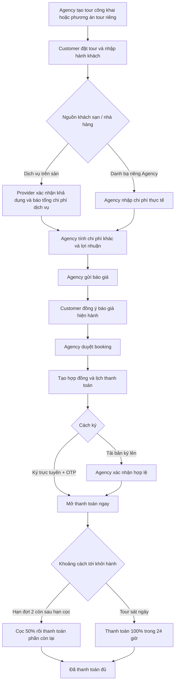

# Demo tạo tour, báo giá, ký hợp đồng và thanh toán

Đối chiếu code `4dd55c2`, kiểm tra ngày 05/11/2026. Giá và thông tin trong ví dụ dưới đây là dữ liệu demo, không phải báo giá thực tế.

## 1. Trạng thái máy đã kiểm tra

- SQL Server: `.\SQLEXPRESS`, database `TripOps`.
- Migration mới nhất đã áp dụng: `20261104134648_AddContractSignSessions`.
- Bảng mới `contract_sign_sessions` có 13 cột, liên kết với `booking_contracts`.
- FE: `http://localhost:5174/`; BE: `http://localhost:5080`; Swagger: `http://localhost:5080/swagger`.
- Máy có đủ cấu hình Cloudinary/payOS trong file cấu hình Development; không sao chép khóa vào tài liệu này. Chưa kiểm tra việc gọi Cloudinary/payOS thật trong đợt kiểm tra này.
- File Development chưa có SMTP. Nếu cấu hình hiệu lực cũng không có SMTP, Development trả OTP demo để hiện trên trang ký. OTP sinh ngẫu nhiên mỗi lần gửi, không phải mật khẩu đăng nhập.
- Đã bỏ `ConnectionStrings__TripOps=Server=localhost...` khỏi `Properties/launchSettings.json`. Chạy `run.bat` sẽ dùng cấu hình kết nối trên máy; profile không còn ghi đè file Development.
- Không tạo booking hoặc thanh toán demo vào database TripOps trong lần kiểm tra này. Dữ liệu tour/booking cho test nằm trong database thử nghiệm riêng.

Tài khoản trên màn hình đăng nhập:

| Vai trò | Email | Mật khẩu demo |
|---|---|---|
| Agency | agency@tripops.test | 12345678 |
| Provider | provider@tripops.test | 12345678 |
| Customer | customer@tripops.test | 12345678 |
| Admin | admin@tripops.test | 12345678 |

Một trình duyệt dùng chung cookie giữa các tab. Để mở nhiều vai trò đồng thời, dùng các trình duyệt/profile khác nhau; hoặc đăng xuất rồi đổi vai trò lần lượt.

## 2. Trình tự nghiệp vụ chính



Nhánh báo giá là bắt buộc với tour riêng, booking có yêu cầu Provider hoặc có khách sạn/nhà hàng khai báo nguồn danh bạ Agency. Một số tour cũ chỉ có dữ liệu nhập tay chưa xác định nguồn có thể được duyệt trực tiếp; không nên lấy nhánh cũ đó để trình bày nghiệp vụ báo giá mới.

## 3. Agency tạo tour công khai

Vào **Quản lý Tour → Tạo Tour mới**, đi qua 5 tab:

1. **Thông tin chung, Ảnh & Điểm đến**: mã tour, tên, điểm đến, chọn tỉnh/thành, số ngày/đêm, giá, số khách, ảnh đại diện.
2. **Chỗ ở, Chỗ ăn & Lịch trình chi tiết**: thiết lập đầy đủ từng ngày, khách sạn, bữa ăn, điểm tham quan. Chọn khách sạn/nhà hàng từ dịch vụ Provider trên sàn hoặc danh bạ riêng Agency. Mỗi nhóm lựa chọn phải có một phương án mặc định.
3. **Bảng giá vé theo độ tuổi**: khai báo khoảng tuổi và giá; không để các khoảng tuổi chồng nhau.
4. **Quy định & Chính sách**: có chính sách hủy và nội dung cần giới thiệu.
5. **Mô phỏng Tour hiển thị**: xem lại trước khi lưu.

Ba cách lưu khác nhau:

| Nút | Kết quả |
|---|---|
| Lưu bản nháp | `draft`, `hidden`; chưa cho khách đặt |
| Lưu hoàn tất (Chưa đăng) | `completed`, `hidden`; chưa xuất hiện trên sàn công khai |
| Hoàn tất & Đăng bán ngay | `completed`, `public`; khách tìm và đặt được nếu Agency đủ điều kiện |

Đề xuất tour demo: **Đà Lạt 2 ngày 1 đêm**, tỉnh **Lâm Đồng**, 2 người lớn, giá dự kiến 3.000.000đ/người. Chọn một khách sạn và một bữa ăn từ Provider để thể hiện đầy đủ bước xác nhận dịch vụ. Chọn ngày **20/11/2026** để demo hai đợt thanh toán nếu thực hiện vào 05/11/2026.

Nếu cần đi nhanh, database hiện có tour công khai **Đà Lạt 3 ngày 2 đêm**, mã **DL-3N2D-001**, giá cơ bản 2.500.000đ. Tuy nhiên phải xem nguồn dịch vụ của tour đó để biết có đi qua nhánh báo giá mới hay không.

## 4. Tour thiết kế riêng khác ở đâu?

1. Customer vào **Yêu cầu thiết kế tour**, chọn Agency và gửi điểm đến, ngày đi/về, số khách, ngân sách, thông tin liên hệ.
2. Agency mở **Yêu cầu thiết kế riêng → Bắt đầu thiết kế hành trình**.
3. Điền form tạo tour như trên, sau đó hoàn tất phương án để chia sẻ cho đúng khách gửi yêu cầu. Có thể tạo nhiều phương án cho cùng yêu cầu.
4. Customer vào **Yêu cầu thiết kế của tôi**, xem phương án và đặt tour.

Tour riêng hoàn tất vẫn có `visibility=hidden`, không phải lỗi. Quyền xem/đặt dựa trên yêu cầu thiết kế của đúng khách, không dựa vào việc đăng công khai.

Customer có thể gửi bản chỉnh phương án; Agency phản hồi hoặc mở bản đó để tiếp tục thiết kế. Bản khách chỉnh lưu riêng, không tự ghi đè tour Agency. Thay đổi phương án booking khi còn chưa thanh toán sẽ yêu cầu báo giá mới; báo giá cũ không còn dùng để chấp thuận.

## 5. Booking → xác nhận dịch vụ → chốt giá

| Bước | Vai trò / màn hình | Thao tác và kết quả mong đợi |
|---|---|---|
| 1 | Customer / chi tiết tour | Chọn ngày, hành khách, dịch vụ rồi đặt; booking ở `Pending`, chưa thanh toán |
| 2 | Provider / Yêu cầu Dịch vụ | Tại **Yêu cầu xác nhận dịch vụ cho booking**, nhập **giá thực tế toàn bộ**, ghi chú, bấm **Xác nhận và báo giá** |
| 3 | Agency / Đặt tour & Khách / chi tiết | Trong **Báo giá theo Tour plan**, kiểm tra các phản hồi Provider; nhập chi phí riêng, **Lãi Agency (tổng đoàn)**, chi phí khác và lý do |
| 4 | Agency | Bấm **Tính và lưu giá**, sau đó **Gửi báo giá cho khách** |
| 5 | Customer / chi tiết booking | Bấm **Đồng ý báo giá này** trên phiên bản hiện hành |
| 6 | Agency / chi tiết booking | Duyệt booking; trạng thái `Confirmed`, sinh hợp đồng và lịch thu tiền theo giá khách đã đồng ý |

Ví dụ tổng đoàn 2 khách:

- Provider xác nhận khách sạn: **3.000.000đ tổng dịch vụ**.
- Provider xác nhận nhà hàng: **2.000.000đ tổng dịch vụ**.
- Agency nhập lợi nhuận: **1.000.000đ tổng đoàn**.
- Báo giá cuối: **6.000.000đ**. Khách chỉ xem giá bán, không được trả chi phí nội bộ/lợi nhuận Agency qua API báo giá.

Điểm dễ làm sai khi demo:

- Giá Provider nhập ở đây là **tổng dịch vụ**, không phải đơn giá mỗi người.
- Nếu có nhiều bữa ăn hoặc khách sạn, phải xác nhận đủ từng yêu cầu.
- Provider từ chối: Agency phải thay phương án trước khi gửi báo giá.
- Provider đổi giá: phải lập/gửi lại và cho khách đồng ý báo giá mới.
- API chặn duyệt khi chưa đồng ý báo giá hiện hành; đây là hành vi đúng.
- Trong code hiện tại, tự động thu thập chi phí Provider tập trung vào khách sạn và bữa ăn; xe/điểm tham quan chưa có quy trình xác nhận tương tự. Có thể nhập chi phí khác trong báo giá Agency.
- Có chỗ chưa thống nhất đơn vị của lưu trú trong danh bạ Agency: UI ghi người/đêm nhưng công thức dòng khách sạn báo giá đang nhân số đêm, không tự nhân số khách. Khi demo nguồn Agency cần kiểm tra số lượng hiển thị và tổng; không mặc định rằng hệ thống đã nhân số khách. Luồng ví dụ phía trên dùng tổng Provider xác nhận để tránh nhầm đơn vị.

## 6. Ký hợp đồng

### Cách A: ký trực tuyến

1. Customer mở chi tiết booking sau khi Agency duyệt.
2. Trong phần hợp đồng, bấm **Ký trực tuyến**.
3. Chọn **Ký ngay trên máy này** để demo nhanh, hoặc quét QR bằng điện thoại.
4. Đọc hợp đồng, vẽ chữ ký, tích đồng ý và bấm gửi OTP.
5. Nếu Development không có SMTP: lấy mã OTP demo được hiển thị ngay trên trang. Nếu đã có SMTP: lấy mã từ email tài khoản.
6. Nhập OTP và hoàn tất ký; xem bản PDF đã có chữ ký.
7. Quay về chi tiết booking. Khi QR đang mở, màn hình kiểm tra trạng thái mỗi 4 giây. Có thể tải lại chi tiết booking nếu chưa thấy cập nhật.

Kết quả: hợp đồng `Signed`, `signMethod=web`; mở thanh toán mà không cần chờ Agency xác nhận. Chữ ký là ảnh vẽ được xác thực OTP, không phải ký bằng USB token/chứng thư số.

Phiên QR hiệu lực 15 phút; tạo phiên mới vô hiệu phiên cũ. OTP hiệu lực 5 phút, gửi lại sau 60 giây, tối đa 5 lần gửi/phiên. Nhập sai OTP 5 lần khóa phiên. Không ký lại/ghi đè một hợp đồng đã ký trực tuyến hoặc đã được xác nhận.

### Cách B: tải bản ký lên

1. Customer tải PDF, ký ngoài hệ thống rồi tải bản PDF/PNG/JPG đã ký lên (tối đa 10 MB).
2. Lúc này trạng thái `Signed`, `signMethod=upload`, **vẫn chưa được thanh toán**.
3. Agency xem bản ký, xác nhận hợp lệ → `Verified` → mở thanh toán. Nếu yêu cầu ký lại thì phải có lý do, khách thực hiện lại.

Không nhầm nội dung mẫu trong modal với file hợp đồng chính thức: dùng **Tải hợp đồng (PDF)** / **Xem bản đã ký** để trình bày file máy chủ lưu.

### Quét QR bằng điện thoại

`localhost` trên điện thoại là điện thoại, không phải máy tính chạy BE/FE. Muốn quét thực tế, chạy FE với host LAN, mở trang qua địa chỉ IP LAN của máy tính, cùng mạng Wi-Fi và cho phép kết nối qua tường lửa. `VITE_PUBLIC_APP_URL` có thể đặt gốc URL LAN/tên miền rồi khởi động lại FE. Để tránh phụ thuộc mạng khi demo, dùng **Ký ngay trên máy này**.

## 7. Thanh toán để demo

| Trường hợp | Lịch thu |
|---|---|
| Hạn đợt 2 còn sau thời điểm duyệt + 24 giờ | Đợt 1: 50% trong 24 giờ; đợt 2: phần còn lại, trước 00:00 ngày khởi hành trừ 7 ngày (giờ VN) |
| Hạn đợt 2 không còn sau hạn cọc | Một đợt 100%, hạn 24 giờ sau khi duyệt |

Ví dụ demo vào 05/11/2026:

- Khởi hành **20/11/2026**, tổng **6.000.000đ**: cọc **3.000.000đ**, còn **3.000.000đ**; hạn đợt 2 hết ngày **12/11/2026**.
- Khởi hành **08/11/2026**: hệ thống thu toàn bộ **6.000.000đ** trong 24 giờ sau khi duyệt.

### Demo không chuyển tiền thật

FE chạy bằng `npm run dev`, BE chạy môi trường Development:

1. Sau khi ký hợp lệ, bấm thanh toán cọc/đợt 2/toàn bộ ở chi tiết booking.
2. Trong modal, chọn **[DEV] Ghi nhận cọc mô phỏng**. Tên nút hiện dùng chữ “cọc” nhưng callback gửi đúng số tiền còn phải trả của đợt được chọn.
3. Sau đợt 1 của lịch hai đợt: `PaymentStatus=PartiallyPaid`, booking vẫn `Confirmed`.
4. Sau khi trả đủ, hoặc thanh toán một đợt toàn bộ: `PaymentStatus=Paid`, booking `Paid`.
5. Xem lịch sử giao dịch có phương thức **Mô phỏng (DEV)**. Đừng trình bày đây là giao dịch đã qua payOS.

### Demo payOS thực

Nút **Thanh toán ... qua payOS** tạo link đến cổng thanh toán thật. Hệ thống chỉ ghi nhận tiền sau khi backend xác minh qua payOS; tham số `status=PAID` trên URL quay về không đủ để đánh dấu đã trả.

Đợt kiểm tra này dùng gateway giả lập, không tạo link hay chuyển tiền thật. Nếu cần trình diễn tích hợp thật, người demo tự thực hiện bước thanh toán và bấm **Kiểm tra thanh toán** nếu trạng thái chưa cập nhật.

## 8. Các tình huống nên trình diễn để thể hiện kiểm tra nghiệp vụ

- Tour thiếu tỉnh/thành hoặc lịch trình từng ngày: không hoàn tất/đăng bán được.
- Khách sạn/nhà hàng riêng Agency thiếu địa chỉ hoặc giá tham khảo: không xuất bản được theo điều kiện nguồn đó.
- Chưa đủ xác nhận dịch vụ: không gửi báo giá được.
- Chưa chấp thuận báo giá hiện hành: Agency không duyệt booking được.
- Chưa ký hợp lệ: không tạo thanh toán được.
- Bản ký tải lên: phải đợi Agency kiểm tra; bản ký OTP mở ngay.
- QR cũ bị thay/hết hạn, OTP sai/hết hạn, không tích đồng ý: bị từ chối ký.
- Gọi kiểm tra thanh toán lặp: không cộng tiền hai lần.
- Link hủy/hết hạn/sai số tiền/chữ ký webhook sai: không ghi có tiền.
- Chọn phương án khác trước khi thanh toán: báo giá và hợp đồng/lịch thu cũ được thay thế theo nghiệp vụ; cần chốt lại.
- Quá hạn thanh toán: chặn trả tiếp; không tự coi như đã hủy booking.

## 9. Bằng chứng kiểm tra và giới hạn

| Kiểm tra | Kết quả |
|---|---|
| Toàn bộ test BE có sẵn | 173 đạt; 1 test SQL opt-in bỏ qua trong lượt đầu |
| Test SQL opt-in chạy riêng trên `.\SQLEXPRESS` | 1 đạt; tạo database `TripOps_Test_<guid>`, áp dụng migration thật, kiểm tra rồi dọn database thử |
| Test bổ sung xuyên suốt tạo tour riêng → Provider → báo giá → ký → payOS giả lập | 2 đạt: hai đợt và một đợt toàn bộ |
| Test FE | 32 đạt |
| TypeScript / build FE | Đạt; build có cảnh báo bundle lớn |
| Giao diện trực tiếp | Đăng nhập Agency, danh sách tour, mở form tạo tour và xem tab dịch vụ; không lưu tour/booking mới |
| SQL TripOps sau kiểm tra | Migration hiện hành; không phát sinh booking từ các test |

Tổng: **176 trường hợp BE khác nhau và 32 test FE đạt**, tính cả test SQL chạy riêng. Không phải chứng nhận đã bấm toàn bộ màn hình trên mọi thiết bị, không bao gồm performance/load test hoặc gửi SMTP/chuyển tiền ngân hàng thật.

Test mới: `backend/tests/TripOps.Tests/TourBookingPaymentJourneyTests.cs`. Kết quả TRX và ảnh đối chiếu ở `.local/flow-review-20261105/` (tệp local, không cần push).

Chạy lại từ thư mục `backend`:

```powershell
dotnet test tests/TripOps.Tests/TripOps.Tests.csproj
```

Chạy riêng hai hành trình hoàn chỉnh (OTP demo, không gửi SMTP):

```powershell
$env:Smtp__Host = ''
dotnet test tests/TripOps.Tests/TripOps.Tests.csproj --filter 'FullyQualifiedName~Custom_tour_provider_quote_contract_and_payos_complete_one_journey'
```
