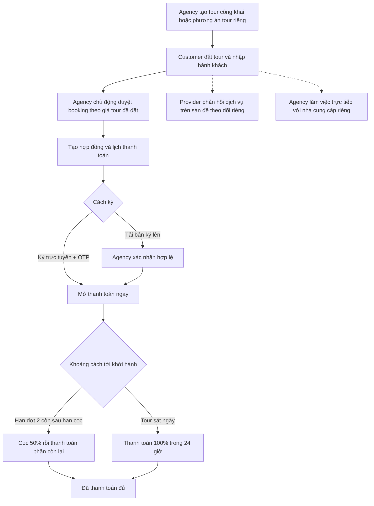

# Demo tạo tour, xác nhận dịch vụ, ký hợp đồng và thanh toán

Cập nhật luồng ngày 09/11/2026: Agency duyệt booking độc lập với phản hồi Provider. Đã bỏ bước Agency lập/gửi báo giá cuối và Customer chấp nhận báo giá. Giá và thông tin ví dụ là dữ liệu demo.

## 1. Trạng thái máy đã kiểm tra

- SQL Server: `.\SQLEXPRESS`, database `TripOps`.
- Migration phụ thu: `20261109114359_AllowBookingSurchargePaymentRequests` (mở rộng check constraint của `payment_requests.stage`; có đủ migration, Designer và ModelSnapshot).
- Bảng mới `contract_sign_sessions` có 13 cột, liên kết với `booking_contracts`.
- FE: `http://localhost:5174/`; BE: `http://localhost:5080`; Swagger: `http://localhost:5080/swagger`.
- Máy có đủ cấu hình Cloudinary/payOS trong file cấu hình Development; không sao chép khóa vào tài liệu này. Chưa kiểm tra việc gọi Cloudinary/payOS thật trong đợt kiểm tra này.
- File Development chưa có SMTP. Nếu cấu hình hiệu lực cũng không có SMTP, Development trả OTP demo để hiện trên trang ký. OTP sinh ngẫu nhiên mỗi lần gửi, không phải mật khẩu đăng nhập.
- Đã bỏ `ConnectionStrings__TripOps=Server=localhost...` khỏi `Properties/launchSettings.json`. Chạy `run.bat` sẽ dùng cấu hình kết nối trên máy; profile không còn ghi đè file Development.
- Không tạo booking hoặc thanh toán demo vào database TripOps trong lần kiểm tra này. Dữ liệu tour/booking cho test nằm trong database thử nghiệm riêng.

Tài khoản trên màn hình đăng nhập:

| Vai trò | Email | Mật khẩu demo |
|---|---|---|
| Agency | agency@tripops.test | 12345678 |
| Provider | provider@tripops.test | 12345678 |
| Customer | customer@tripops.test | 12345678 |
| Admin | admin@tripops.test | 12345678 |

Một trình duyệt dùng chung cookie giữa các tab. Để mở nhiều vai trò đồng thời, dùng các trình duyệt/profile khác nhau; hoặc đăng xuất rồi đổi vai trò lần lượt.

## 2. Trình tự nghiệp vụ chính



Agency được duyệt booking mà không cần chờ Provider xác nhận. Trạng thái phản hồi, số lượng và hạn giữ chỗ của Provider chỉ phục vụ theo dõi dịch vụ; không chặn duyệt hoặc thanh toán. Không cần gửi hay chấp nhận báo giá cuối. Giá Provider là chi phí nội bộ; tổng tiền khách trả theo giá tour/booking đã đặt. Tour riêng vẫn cần khách đồng ý phương án tour trước khi tạo booking.

## 3. Agency tạo tour công khai

Vào **Quản lý Tour → Tạo Tour mới**, đi qua 5 tab:

1. **Thông tin chung, Ảnh & Điểm đến**: mã tour, tên, điểm đến, chọn tỉnh/thành, số ngày/đêm, giá, số khách, ảnh đại diện.
2. **Chỗ ở, Chỗ ăn & Lịch trình chi tiết**: thiết lập đầy đủ từng ngày, khách sạn, bữa ăn, điểm tham quan. Chọn khách sạn/nhà hàng từ dịch vụ Provider trên sàn hoặc danh bạ riêng Agency. Mỗi nhóm lựa chọn phải có một phương án mặc định.
3. **Bảng giá vé theo độ tuổi**: khai báo khoảng tuổi và giá; không để các khoảng tuổi chồng nhau.
4. **Quy định & Chính sách**: có chính sách hủy và nội dung cần giới thiệu.
5. **Mô phỏng Tour hiển thị**: xem lại trước khi lưu.

Ba cách lưu khác nhau:

| Nút | Kết quả |
|---|---|
| Lưu bản nháp | `draft`, `hidden`; chưa cho khách đặt |
| Lưu hoàn tất (Chưa đăng) | `completed`, `hidden`; chưa xuất hiện trên sàn công khai |
| Hoàn tất & Đăng bán ngay | `completed`, `public`; khách tìm và đặt được nếu Agency đủ điều kiện |

Đề xuất tour demo: **Đà Lạt 2 ngày 1 đêm**, tỉnh **Lâm Đồng**, 2 người lớn, giá dự kiến 3.000.000đ/người. Chọn một khách sạn và một bữa ăn từ Provider để thể hiện đầy đủ bước xác nhận dịch vụ. Chọn ngày **20/11/2026** để demo hai đợt thanh toán nếu thực hiện vào 05/11/2026.

Nếu cần đi nhanh, database hiện có tour công khai **Đà Lạt 3 ngày 2 đêm**, mã **DL-3N2D-001**, giá cơ bản 2.500.000đ. Tuy nhiên phải xem nguồn dịch vụ của tour đó để biết có yêu cầu Provider xác nhận hay không.

## 4. Tour thiết kế riêng khác ở đâu?

1. Customer vào **Yêu cầu thiết kế tour**, chọn Agency và gửi điểm đến, ngày đi/về, số khách, ngân sách, thông tin liên hệ.
2. Agency mở **Yêu cầu thiết kế riêng → Bắt đầu thiết kế hành trình**.
3. Điền form tạo tour như trên, sau đó hoàn tất phương án để chia sẻ cho đúng khách gửi yêu cầu. Có thể tạo nhiều phương án cho cùng yêu cầu.
4. Customer vào **Yêu cầu thiết kế của tôi**, xem phương án và đặt tour.

Tour riêng hoàn tất vẫn có `visibility=hidden`, không phải lỗi. Quyền xem/đặt dựa trên yêu cầu thiết kế của đúng khách, không dựa vào việc đăng công khai.

Customer có thể gửi bản chỉnh phương án; Agency phản hồi hoặc mở bản đó để tiếp tục thiết kế. Bản khách chỉnh lưu riêng, không tự ghi đè tour Agency. Agency chỉ duyệt booking một lần. Trước khi duyệt được sửa giá/phương án; sau khi duyệt chỉ đổi dịch vụ, giữ nguyên trạng thái, giá tour gốc, hợp đồng và lịch thu. Chi phí tăng thêm phải tạo phụ thu riêng.

## 5. Booking → Agency duyệt; theo dõi dịch vụ riêng

| Bước | Vai trò / màn hình | Thao tác và kết quả |
|---|---|---|
| 1 | Customer / chi tiết tour | Chọn ngày, hành khách, dịch vụ rồi đặt; booking `Pending` |
| 2 | Agency / chi tiết booking | Chủ động bấm **Duyệt Booking**, không phụ thuộc phản hồi Provider |
| 3 | Provider / Yêu cầu Dịch vụ Đoàn | Phản hồi khả năng cung cấp và tổng chi phí trước hoặc sau khi Agency duyệt; không đổi giá khách trả |
| 4 | Customer / chi tiết booking | Ký hợp đồng rồi thanh toán theo lịch |

Ví dụ tour 3.000.000đ/người, 2 khách: khách trả tổng **6.000.000đ**. Provider xác nhận khách sạn 3.000.000đ và nhà hàng 2.000.000đ là tổng chi phí dịch vụ; không tự đổi giá bán cho khách.

- Provider chưa phản hồi, từ chối, đáp ứng một phần, phản hồi giá mới, thiếu yêu cầu hoặc hết giữ chỗ: Agency vẫn duyệt được.
- Khách ký hợp đồng hợp lệ rồi thanh toán theo lịch; phản hồi/giữ chỗ Provider không phải điều kiện thanh toán.
- Supplier riêng do Agency trực tiếp xác nhận; không tạo phản hồi Provider giả.
- Không còn các API `PUT quotations/draft`, `PUT quotations/terms`, `POST quotations/send`, `POST quotations/{version}/accept` và `POST quotations/{version}/decision`.
- Dữ liệu chi phí và báo giá lịch sử được giữ để đối soát; không cần xóa bảng hay chạy migration cho thay đổi này.

## 6. Ký hợp đồng

### Cách A: ký trực tuyến

1. Customer mở chi tiết booking sau khi Agency duyệt.
2. Trong phần hợp đồng, bấm **Ký trực tuyến**.
3. Chọn **Ký ngay trên máy này** để demo nhanh, hoặc quét QR bằng điện thoại.
4. Đọc hợp đồng, vẽ chữ ký, tích đồng ý và bấm gửi OTP.
5. Nếu Development không có SMTP: lấy mã OTP demo được hiển thị ngay trên trang. Nếu đã có SMTP: lấy mã từ email tài khoản.
6. Nhập OTP và hoàn tất ký; xem bản PDF đã có chữ ký.
7. Quay về chi tiết booking. Khi QR đang mở, màn hình kiểm tra trạng thái mỗi 4 giây. Có thể tải lại chi tiết booking nếu chưa thấy cập nhật.

Kết quả: hợp đồng `Signed`, `signMethod=web`; mở thanh toán mà không cần chờ Agency xác nhận. Chữ ký là ảnh vẽ được xác thực OTP, không phải ký bằng USB token/chứng thư số.

Phiên QR hiệu lực 15 phút; tạo phiên mới vô hiệu phiên cũ. OTP hiệu lực 5 phút, gửi lại sau 60 giây, tối đa 5 lần gửi/phiên. Nhập sai OTP 5 lần khóa phiên. Không ký lại/ghi đè một hợp đồng đã ký trực tuyến hoặc đã được xác nhận.

### Cách B: tải bản ký lên

1. Customer tải PDF, ký ngoài hệ thống rồi tải bản PDF/PNG/JPG đã ký lên (tối đa 10 MB).
2. Lúc này trạng thái `Signed`, `signMethod=upload`, **vẫn chưa được thanh toán**.
3. Agency xem bản ký, xác nhận hợp lệ → `Verified` → mở thanh toán. Nếu yêu cầu ký lại thì phải có lý do, khách thực hiện lại.

Không nhầm nội dung mẫu trong modal với file hợp đồng chính thức: dùng **Tải hợp đồng (PDF)** / **Xem bản đã ký** để trình bày file máy chủ lưu.

### Quét QR bằng điện thoại

`localhost` trên điện thoại là điện thoại, không phải máy tính chạy BE/FE. Muốn quét thực tế, chạy FE với host LAN, mở trang qua địa chỉ IP LAN của máy tính, cùng mạng Wi-Fi và cho phép kết nối qua tường lửa. `VITE_PUBLIC_APP_URL` có thể đặt gốc URL LAN/tên miền rồi khởi động lại FE. Để tránh phụ thuộc mạng khi demo, dùng **Ký ngay trên máy này**.

## 7. Thanh toán để demo

| Trường hợp | Lịch thu |
|---|---|
| Hạn đợt 2 còn sau thời điểm duyệt + 24 giờ | Đợt 1: 50% trong 24 giờ; đợt 2: phần còn lại, trước 00:00 ngày khởi hành trừ 7 ngày (giờ VN) |
| Hạn đợt 2 không còn sau hạn cọc | Một đợt 100%, hạn 24 giờ sau khi duyệt |

Ví dụ demo vào 05/11/2026:

- Khởi hành **20/11/2026**, tổng **6.000.000đ**: cọc **3.000.000đ**, còn **3.000.000đ**; hạn đợt 2 hết ngày **12/11/2026**.
- Khởi hành **08/11/2026**: hệ thống thu toàn bộ **6.000.000đ** trong 24 giờ sau khi duyệt.

### Demo không chuyển tiền thật

FE chạy bằng `npm run dev`, BE chạy môi trường Development:

1. Sau khi ký hợp lệ, bấm thanh toán cọc/đợt 2/toàn bộ ở chi tiết booking.
2. Trong modal, chọn **[DEV] Ghi nhận cọc mô phỏng**. Tên nút hiện dùng chữ “cọc” nhưng callback gửi đúng số tiền còn phải trả của đợt được chọn.
3. Sau đợt 1 của lịch hai đợt: `PaymentStatus=PartiallyPaid`, booking vẫn `Confirmed`.
4. Sau khi trả đủ, hoặc thanh toán một đợt toàn bộ: `PaymentStatus=Paid`, booking `Paid`.
5. Xem lịch sử giao dịch có phương thức **Mô phỏng (DEV)**. Đừng trình bày đây là giao dịch đã qua payOS.

### Demo payOS thực

Nút **Thanh toán ... qua payOS** tạo link đến cổng thanh toán thật. Hệ thống chỉ ghi nhận tiền sau khi backend xác minh qua payOS; tham số `status=PAID` trên URL quay về không đủ để đánh dấu đã trả.

Đợt kiểm tra này dùng gateway giả lập, không tạo link hay chuyển tiền thật. Nếu cần trình diễn tích hợp thật, người demo tự thực hiện bước thanh toán và bấm **Kiểm tra thanh toán** nếu trạng thái chưa cập nhật.

## 8. Các tình huống nên trình diễn để thể hiện kiểm tra nghiệp vụ

- Tour thiếu tỉnh/thành hoặc lịch trình từng ngày: không hoàn tất/đăng bán được.
- Khách sạn/nhà hàng riêng Agency thiếu địa chỉ hoặc giá tham khảo: không xuất bản được theo điều kiện nguồn đó.
- Agency duyệt được khi Provider chưa xác nhận, từ chối hoặc hết hạn giữ chỗ.
- Provider được phản hồi sau khi Agency duyệt, giữ nguyên trạng thái booking và tổng tiền khách trả.
- Chưa ký hợp lệ: không tạo thanh toán được.
- Bản ký tải lên: phải đợi Agency kiểm tra; bản ký OTP mở ngay.
- QR cũ bị thay/hết hạn, OTP sai/hết hạn, không tích đồng ý: bị từ chối ký.
- Gọi kiểm tra thanh toán lặp: không cộng tiền hai lần.
- Link hủy/hết hạn/sai số tiền/chữ ký webhook sai: không ghi có tiền.
- Sau khi duyệt: API sửa giá và đổi toàn bộ phương án bị khóa. Agency đổi khách sạn/bữa ăn không cần duyệt lại, kể cả khi đã thanh toán.
- Nút **Thêm phụ thu**: nhập số tiền dương và lý do đã thống nhất với khách. Phụ thu có khoản thanh toán riêng và không đổi hợp đồng/giá tour gốc. Khách có thể thanh toán từng phụ thu độc lập, kể cả trước tiền cọc hoặc các phụ thu khác; đợt 2 vẫn chỉ mở khi đủ cọc. FE gửi `paymentRequestId` của khoản đã chọn tới API payOS; số tiền do BE tính.
- Tạo phụ thu có khóa chống gửi lặp; gửi lại cùng yêu cầu không tăng tiền hai lần.
- Tổng phải trả = giá tour đã chốt + các phụ thu. Hạn phụ thu không sớm hơn 24 giờ kể từ tạo và hạn thu tiền tour.
- Quá hạn thanh toán: chặn trả tiếp; không tự coi như đã hủy booking.

## 9. Kiểm tra và giới hạn

Lượt kiểm tra trước thay đổi quy tắc duyệt: 159 trường hợp BE liên quan đạt qua các lượt kiểm tra, gồm hai hành trình tạo tour riêng → Provider xác nhận → Agency duyệt → ký OTP demo → payOS giả (hai đợt và thu toàn bộ). Một test SQL opt-in không chạy trong lượt này. FE có 53 test đạt, typecheck/build đạt.

Quy tắc hiện hành: giữ nguyên giá khách đặt dù chi phí Provider khác giá bán; phản hồi Provider không chặn duyệt hay thanh toán; chặn thanh toán trước ký; không cộng tiền hai lần; cho trả phần còn lại sau cọc dù hạn giữ chỗ ban đầu đã qua. Không gửi SMTP hoặc chuyển tiền thật trong test.

Các file test trọng tâm:

- `backend/tests/TripOps.Tests/ProviderApprovalWithoutQuotationTests.cs`
- `backend/tests/TripOps.Tests/TourBookingPaymentJourneyTests.cs`
- `frontend/tests/bookingSupplierStatus.test.ts`

```powershell
cd backend
dotnet test tests/TripOps.Tests --filter 'FullyQualifiedName~TourFlowTests|FullyQualifiedName~BookingFlowTests|FullyQualifiedName~OpenApiTests'
```

## Duyệt một lần và phụ thu

- POST `/api/v1/agency/bookings/{id}/price-adjustments`: chỉ trước lần duyệt đầu tiên.
- POST `/api/v1/agency/bookings/{id}/service-changes`: sau duyệt bắt buộc `priceDifference = 0`; không đặt booking về Pending.
- POST `/api/v1/agency/bookings/{id}/surcharges`: `{ amount, reason, expectedTotal, requestId }`, `requestId` là UUID chống lặp.
- Phụ thu lưu trong `payment_requests` với stage nội bộ `fee:...`, trả API thành stage `surcharge`; lưu lịch sử trong `booking_price_adjustments`. Không thêm bảng/cột.
- DTO có `baseTourAmount`, `surchargeAmount`, `hasBeenApproved`. Hợp đồng và các đợt tour lấy giá tour gốc; tổng booking bao gồm phụ thu.

## Agency bổ sung hành khách

- Customer vẫn nhập danh sách khi đặt tour ban đầu; sau khi đã có booking, chỉ Agency sở hữu tour được bổ sung hành khách.
- POST `/api/v1/agency/bookings/{id}/participants`: họ tên, ngày sinh, giới tính, CCCD/hộ chiếu (tùy chọn), xếp phòng, ăn uống/dị ứng, hỗ trợ đặc biệt, giá vé và lý do. Không thu số điện thoại riêng của hành khách.
- Trước duyệt: tiền vé bổ sung vào giá tour. Sau duyệt: giá tour gốc không đổi, tiền vé > 0 thành phụ thu riêng. Vé 0đ không tạo khoản thu. Booking/hợp đồng/lịch thu hiện có giữ nguyên.
- Client gửi `requestId` UUID; `booking_participants.creation_key` chống thêm người và thu phí hai lần khi gửi lại yêu cầu.
- Migration mới nhất `20261109122909_AddAgencyParticipantCreationKey`: thêm cột nullable `creation_key` và unique index có điều kiện; có Designer/ModelSnapshot. Không thay đổi các hồ sơ đã có.
- Customer không được thêm người qua API chỉnh phương án; API sửa danh sách chỉ cập nhật hồ sơ có sẵn.

- Danh sách hành khách trên trang Customer chỉ để xem; Agency quản lý việc thêm/sửa/xóa sau khi tạo booking. API sửa hồ sơ và đổi danh sách qua phương án tour cũng chặn Customer.

- Migration `20261109133553_RenameBookingCustomizedColumnsToCurrent` đổi tên cột, giữ nguyên dữ liệu: `booking_hotels.current_hotel_name`, `booking_hotels.current_stars`, `booking_restaurants.current_restaurant_name`, `booking_locations.current_location_name`. Các cột `original_*` và cờ `is_customized` không đổi. Team pull code cần chạy `dotnet ef database update --project src/TripOps.Data --startup-project src/TripOps.Api` từ thư mục backend.

### Agency đổi điểm tham quan của booking

- `POST /api/v1/agency/bookings/{id}/location-changes`: `itemId`, `name`, `reason`, `expectedTotal`, `priceDifference` (0 sau khi đã duyệt). Chỉ Agency chủ trì được đổi điểm mình quản lý, trước khi thực hiện tour/check-in.
- Lưu vào `booking_locations.current_location_name`; giữ nguyên `original_location_name`. Chỉ lưu lý do hiện tại trong `customer_note`, không thêm bảng lịch sử dịch vụ.
- Các snapshot trả `name` hiện tại và `originalName` lúc đặt; điểm tham quan trả thêm `changeReason`. Agency/Customer cùng nhìn thấy, bản đồ Customer tìm theo tên hiện tại.
- Khách sạn/nhà hàng khách chọn lúc tạo booking là giá trị `original_*`, dù khác phương án mặc định của tour. Các lần đổi tiếp theo chỉ ghi vào `current_*`.
- Migration dữ liệu `20261109140022_PreserveBookedOriginalServiceNames` khởi tạo `current_*` đang NULL và sửa tên gốc khách sạn/nhà hàng cũ khi bản chi phí đầu tiên có đúng slot. Không phỏng đoán tên gốc khi không có dữ liệu đối chiếu.
